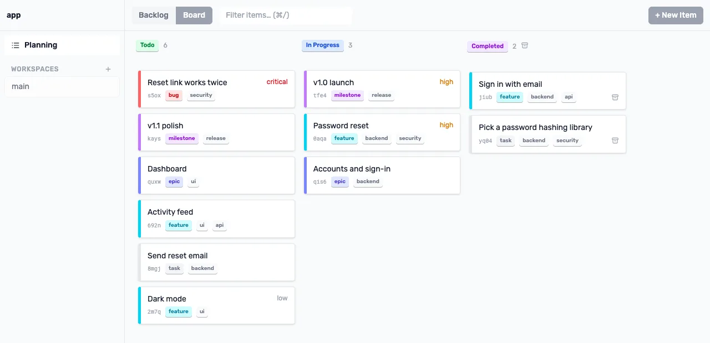

<p align="center"></p>

<p align="center">
  <a href="https://github.com/rierek/lif/releases"></a>
  <a href="LICENSE"></a>
  <a href="https://go.dev/"></a>
  <a href="https://github.com/rierek/lif/actions/workflows/test.yml"></a>
  <a href="https://github.com/rierek/lif/actions/workflows/docs.yml"></a>
  <a href="https://rierek.github.io/lif/"></a>
  <a href="https://github.com/rierek/lif/stargazers"></a>
</p>

<p align="center">
  <a href="https://rierek.github.io/lif/">Docs</a> ·
  <a href="https://rierek.github.io/lif/overview/installation/">Install</a> ·
  <a href="https://rierek.github.io/lif/overview/first-steps/">First steps</a> ·
  <a href="https://rierek.github.io/lif/features/">Features</a> ·
  <a href="https://rierek.github.io/lif/use-cases/">Use cases</a> ·
  <a href="https://rierek.github.io/lif/reference/">Reference</a> ·
  <a href="https://rierek.github.io/lif/releases/">Releases</a> ·
  <a href="https://rierek.github.io/lif/blog/">Blog</a>
</p>

# Lif

**Plan in Markdown. Keep it in Git.**

Lif is a lightweight work tracker. Every item is one Markdown file, a Liff, that sits next to your code. Humans edit it, AI agents query it, scripts automate it.


## One backlog, many surfaces

| | |
| --- | --- |
| **CLI**<br>Create, query and update items from the shell. Most commands take `--json`.<br>[→ Commands](https://rierek.github.io/lif/reference/commands/)<br><br> | **TUI**<br>Browse the item tree, filter by type, status, priority or tag, and edit without leaving the terminal.<br>[→ TUI reference](https://rierek.github.io/lif/reference/tui/views/)<br><br> |
| **Web**<br>Run `lif-serve` and open `localhost:8080` for the same items as a board in your browser.<br>[→ Web server](https://rierek.github.io/lif/reference/web-server/)<br><br><picture><source media="(prefers-color-scheme: dark)" srcset="site/public/media/web-board-dark.webp"></picture> | **Markdown**<br>Every item is one Markdown file with YAML front matter. Read it, edit it by hand, diff it like code.<br>[→ Item file format](https://rierek.github.io/lif/reference/item-file-format/)<br><br>`.lif/app-pgha--password-reset.md`<pre>---<br># app-pgha<br>title: Password reset<br>status: in-progress<br>type: feature<br>priority: high<br>tags:<br>    - backend<br>    - security<br>parent: app-dbg0<br>---<br><br>Let users reset a forgotten<br>password with a one-time link.</pre> |

## Install

```sh
brew install rierek/lif/lif
# or
curl -fsSL https://raw.githubusercontent.com/rierek/lif/main/install.sh | sh
```

→ [All install options](https://rierek.github.io/lif/overview/installation/) (Nix, `go install`, source build) · → [Upgrading](https://rierek.github.io/lif/overview/upgrading/)

## Quick start

```sh
mkdir lif-demo && cd lif-demo
lif init --profile todo
lif create "Ship the first documented change" --type task --priority high --status todo
lif list --ready
lif next
```

Lif creates `.lif.yml` plus a `.lif/` directory. Commit both with the repository so task history and code history travel together.

→ [First steps](https://rierek.github.io/lif/overview/first-steps/) · → [Concepts](https://rierek.github.io/lif/overview/concepts/)

## Features

- **Files in your repo.** Your backlog is a folder of files; everything that reads files already speaks Lif. → [Files in your repo](https://rierek.github.io/lif/features/files-in-your-repo/)
- **Flexible planning.** Types, ranks, statuses and presets shape the plan to your project. → [Flexible planning](https://rierek.github.io/lif/features/project-planning/)
- **Dependencies.** Blocking links, ready work and the dependency graph show what you can start now. → [Dependencies](https://rierek.github.io/lif/features/dependencies/)
- **Automation and agents.** JSON output, GraphQL and `lif prime`, with no server. → [Automation](https://rierek.github.io/lif/features/automation/)
- **Surface independence.** Terminal, board or editor: all of them work on the same files. → [Surface independence](https://rierek.github.io/lif/features/surface-independence/)

## Use cases

[Software projects](https://rierek.github.io/lif/use-cases/software-projects/) · [Release management](https://rierek.github.io/lif/use-cases/release-management/) · [Personal tasks](https://rierek.github.io/lif/use-cases/personal-tasks/) · [Home lab](https://rierek.github.io/lif/use-cases/homelab/) · [Writing and research](https://rierek.github.io/lif/use-cases/writing-research/)

## Project profiles

`lif init --profile <name>` writes one preset into `.lif.yml`. → [Flexible planning](https://rierek.github.io/lif/features/project-planning/)

| Profile | Shape |
| --- | --- |
| `todo` | Flat task list, grouped by tags. |
| `simple` | Milestones, epics, features, tasks and bugs; roadmap-excluded buckets for future work. |
| `classic` | `milestone → epic → feature → task/bug`, the original hierarchy. |
| `complex` | Explicit releases, with customer-value types such as stories and chores. |

## Use with coding agents

Add one line to your repository instructions:

```markdown
Before managing project work, run `lif prime` and follow its project-specific instructions.
```

`lif prime` reflects the configured types, statuses and policies of the repository, so it stays correct where a copied command manual goes stale. → [Agent onboarding](https://rierek.github.io/lif/overview/agent-onboarding/)

## Reference

[Commands](https://rierek.github.io/lif/reference/commands/) · [Configuration](https://rierek.github.io/lif/reference/configuration/) · [Item file format](https://rierek.github.io/lif/reference/item-file-format/) · [JSON output](https://rierek.github.io/lif/reference/json-output/) · [GraphQL](https://rierek.github.io/lif/reference/graphql/) · [Search syntax](https://rierek.github.io/lif/reference/search-syntax/) · [Web server](https://rierek.github.io/lif/reference/web-server/) · [TUI](https://rierek.github.io/lif/reference/tui/views/) · [Glossary](https://rierek.github.io/lif/reference/glossary/)

## Resources

[Releases](https://rierek.github.io/lif/releases/) (latest: [v0.14.1](https://rierek.github.io/lif/releases/v0-14-1/)) · [Blog](https://rierek.github.io/lif/blog/) · [Known limitations](https://rierek.github.io/lif/known-limitations/) · [Troubleshooting](https://rierek.github.io/lif/overview/troubleshooting/)

## Contributing

Issues, discussions and focused pull requests are welcome at [rierek/lif](https://github.com/rierek/lif). Pull requests target the current `milestone/0.N` branch, not `main`; see [CONTRIBUTING.md](CONTRIBUTING.md).

## Acknowledgements

Lif originated as a fork of [hmans/beans](https://github.com/hmans/beans) by [Hendrik Mans](https://github.com/hmans), released under the Apache License 2.0. See [About](https://rierek.github.io/lif/about/) for the lineage.

## License

Licensed under the [Apache License 2.0](LICENSE).
