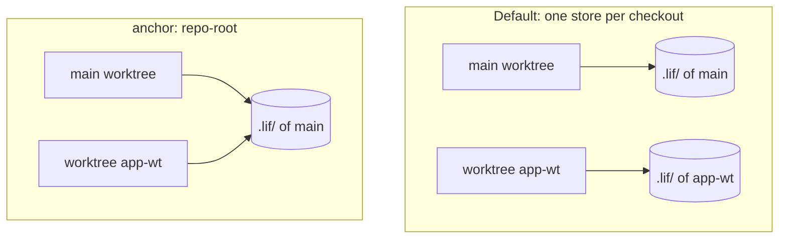

import WhyItMatters from '../../site/src/components/WhyItMatters.astro';

**Wrong items? Ask Lif which store it uses.** Run `lif path`. It prints the store directory that every command in this folder reads and writes. The common case needs no setup: one project, one store, versioned with the code.

## How it looks

```bash
cd ~/app
lif path        # /Users/you/app/.lif
```

`lif init` creates `.lif.yml` and the store folder `.lif/` in the project folder. Lif searches for `.lif.yml` upward from the current directory, and the nearest one wins. The store is the directory the config names with `lif.path`, by default `.lif/` next to the config file. A relative `lif.path` is joined to the folder of the config file. An absolute path is used as it is.

Outside a project, Lif tells you:

```text
Error: no .lif directory found at /tmp/nolif/.lif (run 'lif init' to create one)
```

Run `lif init` there, or point at a store with `--lif-path <dir>`.

<WhyItMatters>
**Each project keeps its backlog in its own repository.** Branches, reviews and history of the backlog come with the code. See [Files in your repo](../../features/files-in-your-repo/).
</WhyItMatters>

## Worktrees and a shared store

A Git worktree is a separate checkout. By default it has its own copy of the store, so each branch carries its own items. A new item created in the worktree stays there:

```bash
cd ../app-wt && lif path        # /Users/you/app-wt/.lif  (own store)
```

To make all worktrees of a repository use one store, set `anchor` in `.lif.yml`:

```yaml
lif:
  anchor: repo-root
```

From a secondary worktree, Lif now resolves the store against the main worktree. `lif path` there prints the store of the main checkout. In the main worktree and outside Git nothing changes. Any other value for `anchor` is a config error.



Choose by need: an own store keeps items with the branch. A shared store shows every worktree the same items at once.

## Steer the store for one call

- `--lif-path <dir>` works on every command and beats the config file and the environment. Use it for a scratch store: `lif init --lif-path /tmp/scratch` creates the store and writes no config file.
- `LIF_PATH` applies only when there is neither a flag nor a config file. A config file that Lif finds always wins, so a variable exported by a tool such as direnv does not redirect unrelated projects.
- Setting both `LIF_PATH` and the legacy `BEANS_PATH` is an error. Unset one of them.

The full precedence is a table in [Configuration](../../reference/configuration/).

## Several projects, one store

Point `lif.path` (absolute), `--lif-path` or `LIF_PATH` of several projects at one directory to share it. The items then belong to no single repository. Give each project its own ID prefix first: Lif does not report a duplicate ID in `lif check`, and the later file silently overwrites the earlier one. Set the prefix with `lif rename --prefix <new>` (try `--dry-run` first).

To switch between projects in the terminal UI, see [TUI: start and repositories](../../reference/tui/start-and-repositories/).

## Limits

- `lif init` stops with an error when a config file already exists in the directory, so a second run cannot overwrite it. `lif init --force` replaces the config with the default config; items and an existing store `.gitignore` stay.
- A prefix change is refused while `lif-serve` runs or extra worktrees exist. `lif rename --prefix <new> --dry-run` prints the plan and then lists every refusal, and exits with a non-zero code if there is any. Stop `lif-serve` and remove extra worktrees before the real run.
- Which types and statuses apply when several projects with different configs share one store is not documented. Use one config for all projects that share a store.

## Reference

- [Configuration](../../reference/configuration/): precedence table, `lif.path`, `anchor`, `prefix`.
- [`lif path`](../../reference/commands/lif-path/), [`lif init`](../../reference/commands/lif-init/), [`lif rename`](../../reference/commands/lif-rename/).
- [Glossary](../../reference/glossary/).
