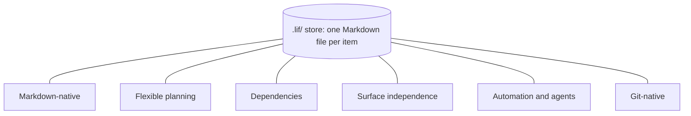

Lif is a file-based item tracker for people and coding agents. Each feature below is a capability, not a command. Commands only show the capability. Measured on Lif 0.14, 2026-10-14.

## What Lif can do

- [Markdown-native](../markdown-native/): every item is a plain Markdown file you can read, diff and edit anywhere.
- [Flexible planning](../project-planning/): types, ranks, statuses and presets that you shape to your project.
- [Dependencies](../dependencies/): `blocking` and `blocked_by` links, and `lif next` for "what can I start now?".
- [Surface independence](../surface-independence/): CLI, TUI, Web UI and your editor work on the same store.
- [Automation and agents](../automation/): `--json`, GraphQL and `lif prime` for scripts and coding agents.
- [Git-native](../git-native/): items live in the repository and travel with your code.

Every feature page follows one pattern: what, why, how it looks, limits, reference links. How-to guides sit in collapsed sections on the matching page. Each Limits section says plainly what Lif does not check.

## How the features fit together

An item is a Markdown file in the store. The store is the directory `.lif/` next to the configuration `.lif.yml`. All other features build on that file.

- Planning (type, rank, `parent`) and dependencies (`blocking`, `blocked_by`) are relations between files. `lif next` and `lif roadmap` read both.
- Every writing path (CLI, GraphQL, TUI, Web UI) goes through the same item logic and enforces the same configured rules. You can also edit the files directly. Lif does not check such edits on load. Run `lif check` afterwards.
- The store lives in the repository, so items travel with the code. Automation and agents work on the same files.

## Which feature answers which question

| Question | Feature | Entry point |
|---|---|---|
| Can I read and change my data without Lif? | [Markdown-native](../markdown-native/) | [Item file format](../../reference/item-file-format/) |
| How do I model milestones, epics and tasks? | [Flexible planning](../project-planning/) | `lif init --profile` |
| What can I start now, what blocks me? | [Dependencies](../dependencies/) | `lif next` |
| Can I mix CLI, TUI, Web UI and my editor? | [Surface independence](../surface-independence/) | `lif tui` |
| How do I connect scripts or coding agents? | [Automation and agents](../automation/) | `lif prime`, `--json` |
| How does this work with branches, worktrees and commits? | [Git-native](../git-native/) | `lif.anchor: repo-root` |

## Where to go next

- [Use cases](../../use-cases/): the same features in five worked scenarios.
- [Reference](../../reference/): commands, item file format, configuration, GraphQL.
- [Agent onboarding](../../overview/agent-onboarding/): the entry point for coding agents.
- [Known limitations](../../known-limitations/): open defects with workarounds.
