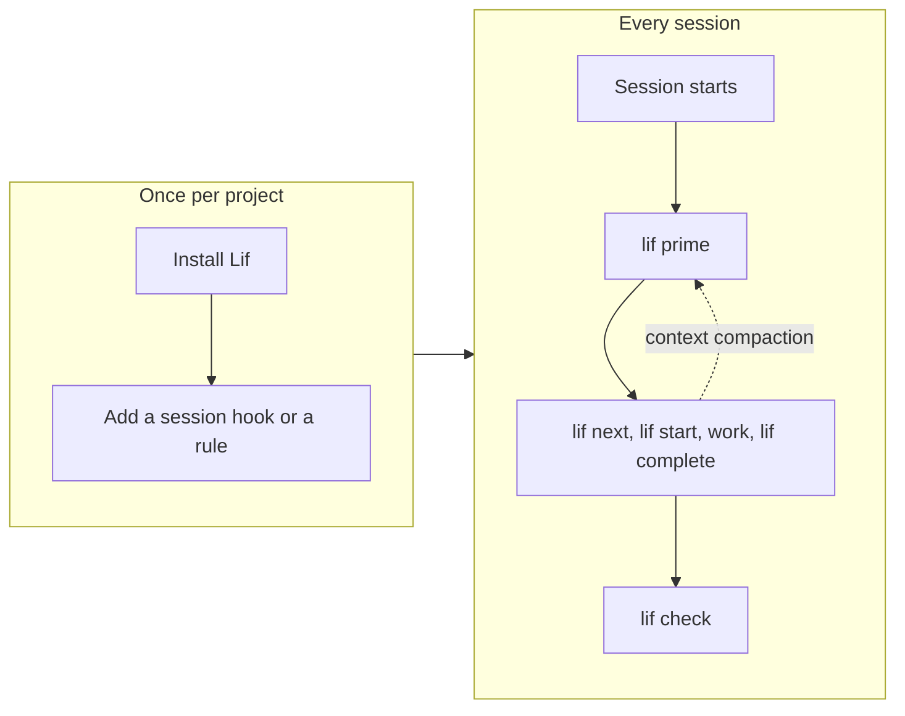

## Purpose
Gets a coding agent productive with Lif quickly and keeps it from drifting away from the store. Recommends hooks (re-priming and pre-commit); the docs only show snippets, nothing is shipped.

## Audience
People who set up a coding agent (Claude Code, OpenCode, others) with Lif, and agents that orient themselves. Basic knowledge of items and `lif` from Concepts (`overview/concepts`) helps.

## Required sections

### How an agent learns Lif
- Lif ships no skill (D58). `lif prime` and `lif --help` are everything an agent needs; teams may add their own skill that points to this documentation (see Own skills).
- No website needed: an agent learns Lif from the binary alone. `lif prime` prints a usage guide generated for the project at hand, `lif --help` documents every command, and the prime guide contains no web links. This site is for humans.
- Order: `lif prime` first, then `lif --help` for syntax details.
- `prime` and `--help` run without a loaded store; all other commands need one.
- Shows the tagline "A file-based issue tracker for AI-first workflows" as the guiding idea.
- Includes a Mermaid diagram of the onboarding steps: install Lif, add a session hook or rule, then per session `lif prime`, work, `lif check`, and `lif prime` again after context compaction. The diagram below is the working proof; phase 5 refines it.
- Source: FACTS.md §1.0 (root texts, bootstrap skip), §1.1 (`prime`); DESIGN.md D24, D53, D58; `internal/commands/prompt.tmpl` (no web links); `wiki/agent-integration.md` (prime is generated from the project's configuration).

### lif prime
- `lif prime` prints a prompt that instructs agents in the use of Lif; it has no flags.
- Shows `lif prime` with shortened example output (phase 5: run it for real).
- Explains: the text comes from a template in the code (`internal/commands/prompt.tmpl`) and contains command facts; it also mentions `lif check --strict`.
- Explains: outside a Lif project (no config file found) `lif prime` prints nothing and exits without an error, so it only helps once `lif init` has run.
- Lists the sections of the output as in the template: Recipes, CLI Commands, Relationships, Item Types, Statuses, Priorities, Modifying Item Body Content, Custom Front Matter, Required Fields on Status Transitions, Review Findings and Attachments, Manual Ordering, Display Configuration, Output Flags, Failure Output, Concurrency Control, GraphQL Queries. (TODO: verify against a real run, the template fills some sections from the configuration.)
- Source: FACTS.md §1.1 (`prime`), §6.10 (reference to `prompt.tmpl:203`); `internal/commands/prompt.tmpl:2-341` (section headings); `internal/commands/prime.go:71-104` (silent without a config; not yet in FACTS.md). The rendered contents are `TODO: verify` (check with `lif prime` in phase 5).

### Session hooks
- Idea: the agent reads `lif prime` automatically instead of relying on memory.
- Claude Code: hooks on `SessionStart` and `PreCompact` run `lif prime`.
- Shows a short snippet of the hook configuration (phase 5: take it from the existing configuration and test it).
- Alternative to a hook: a Claude Code rule in `.claude/rules/` that tells the agent to run `lif prime` before anything else. A rule only instructs the agent; a hook runs the command itself. Claude Code treats rules as context, not enforced configuration.
- A rule file without `paths:` frontmatter loads at session start for every file; after compaction it is re-injected from disk. A rule with `paths:` loads only when Claude touches a matching file, so it is the wrong choice for a start-of-session instruction. Say so.
- Shows a rule file of a few lines. Links to the Claude Code documentation pages "How Claude remembers your project" (`https://code.claude.com/docs/en/memory`) "What survives compaction" (`https://code.claude.com/docs/en/context-window`) and the `.claude` directory reference (`https://code.claude.com/docs/en/claude-directory#ce-rules`), and states the version and date on which the claims were checked.
- Disclaimer (D67), shown in a note box: statements about third-party software (Claude Code, OpenCode, Obsidian) come from their public documentation at the stated date; they can change, and no warranty is given for them.
- Agents without hooks: paste the prompt once, or point to `lif prime` in the agent instruction file. (TODO: verify)
- Source: FACTS.md §6.10, §9(f) (Claude Code hooks run `lif prime`, `.claude/settings.json`, `extras/claude/plugins/lif-prime/hooks/hooks.json`); DESIGN.md D53, D67; Claude Code docs `claude-directory` (anchor `#ce-rules`: "A rule without `paths:` frontmatter loads at session start like CLAUDE.md"; rules are guidance, not enforced), `memory` (rules without `paths` load unconditionally; "Claude treats them as context, not enforced configuration") and `context-window` section "What survives compaction" (project-root CLAUDE.md and unscoped rules re-injected from disk; rules with `paths:` reload on demand), read 2026-10-14. Hook snippet and behaviour without hooks stay `TODO: verify`.

### Drift prevention hook
- Problem: after context compaction an agent forgets the rules or edits files in the store by hand; the store drifts from what is intended.
- Recommendation 1, re-priming: a session hook that runs `lif prime` at session start and before context compaction (`PreCompact`). Shows the snippet.
- Recommendation 2, pre-commit: a Git hook that runs `lif check`; exit code 1 on a finding aborts the commit. Shows the snippet (a script with `lif check`, executable as `.git/hooks/pre-commit` or through the project's usual hook manager).
- Nothing is shipped: the docs only show the snippets, every project sets them up itself (D41). Links to Git-native (`features/git-native`).
- Known limit (D40): `lif check` checks the config, unknown types, broken links, self-references, cycles, required fields (warning only), unknown commit SHAs (warning) and orphaned attachment directories. It does not check parent/child ranks, status and priority values, tag format, duplicate IDs or file name/ID mismatches.
- Consequence: the pre-commit hook only partly catches drift from manual edits; warnings only count with `lif check --strict`; the docs follow once the extended check ships.
- Source: FACTS.md §6.8, §6.9, §6.10, §6.11, §9(e), §9(f); DESIGN.md D40, D41. The hook snippets themselves are to be built and tested in phase 5 (test: a commit with a deliberately broken link).

### Rules for agents
- Read through `--json` (`lif list --json`, `lif show --json`, `lif next --json`), do not parse text.
- Write through the CLI (`lif create`, `lif update`, `lif start`, `lif complete`), because only these paths enforce the rules.
- Never rename IDs by hand, use `lif rename` (updates references). (TODO: verify)
- Run `lif check` after every manual edit and check the exit code.
- Short ID and full ID are both valid.
- Errors as JSON: codes such as `NOT_FOUND`, `VALIDATION_ERROR`, `CONFLICT`.
- Source: FACTS.md §1.0, §1.1 (`rename`, `check`, `list`, `show`, `next`), §3.1, §3.2, §6.8. The statement "`lif rename` updates references" is `TODO: verify` (check with `lif rename --help` and `internal/commands/rename.go`).

### Own skills
- Lif ships no skill (D58). A skill is individual to a team's conventions, so each team writes its own if it needs one.
- A project skill should only point to this documentation and to `lif prime`, not duplicate them.
- Demarcation: `prime` delivers facts from the commands, a skill delivers a team's way of working.
- Source: DESIGN.md D58. Where a skill lives and how an agent loads it differs per agent: `TODO: verify`.

### Setup per agent
- All agents: install the `lif` binary first, then add one of the mechanisms below.
- Claude Code: plugin `lif-prime` with hooks for `SessionStart` and `PreCompact` (add the install commands), or a rule in `.claude/rules/`.
- OpenCode: plugin in the `.opencode` directory (add the installation steps).
- Other agents: paste `lif prime` once or let the agent call it as a command.
- Table: agent · mechanism · commands.
- Source: FACTS.md §6.10 (Claude Code hooks confirmed). OpenCode and plugin installation steps are `TODO: verify` (check in `extras/claude/plugins/lif-prime/README.md`, `.opencode/plugin`, `wiki/agent-integration.md`).

### Example first session
- Example flow as a transcript: `lif prime` → `lif next` → `lif start` → work → `lif complete --summary` → `lif check`.
- Comments each step in one line.
- Shows `--json` output where an agent parses it.
- Source: FACTS.md §1.1 (`prime`, `next`, `start`, `complete`, `check`), §6.8. The transcript is to be produced with a real run in phase 5 (`TODO: verify`).
