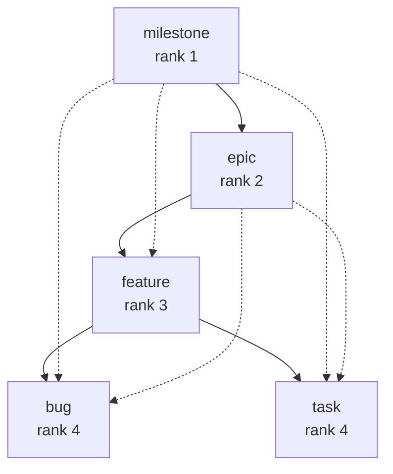

## Purpose
Conveys Lif's mental model in plain words before the reader opens the Reference. Canonical rules and tables stay in the Reference; this page explains and links, it does not repeat rules.

## Audience
New users and agents who want to understand, after installation, how items, hierarchy, order and dependencies fit together. No prior knowledge of Lif needed.

## Required sections

### Item and Liff
- An item is a unit of work; it lives as one Markdown file in the store (YAML front matter plus Markdown body).
- Names the term Liff for that file, with a link to Reference: Item file format (`reference/item-file-format`) as the definition (D47).
- Explains: ID and slug come from the file name `<id>--<slug>.md`, not from the front matter.
- Explains: additional front matter keys are preserved.
- Shows a small example Liff (phase 5: generate it with `lif create`).
- Source: FACTS.md §2.1, §2.2, §2.4; DESIGN.md D47

### Type and rank
- Type = the kind of item (for example `milestone`, `epic`, `feature`, `bug`, `task`); every type has a rank (an integer).
- Shows the built-in mapping as a table: milestone 1, epic 2, feature 3, bug 4, task 4.
- Ranks 1 to 3 are containers, rank 4 is the leaf; in prose "level" is a synonym for rank, never a field name.
- Custom types are possible and can have deeper ranks; there is no hard upper limit (D39).
- An item without a type is loaded as `task`.
- Links to Reference: Configuration (`reference/configuration`) for types and ranks.
- Source: FACTS.md §2.2, §2.3, §3, §9(a); DESIGN.md D39, D45

### Status
- Status describes progress; built-in values: `in-progress`, `todo`, `draft`, `completed`, `scrapped`.
- `completed` and `scrapped` are archive statuses; `lif archive` moves such items to `archive/`.
- New items get `todo` unless something else is set.
- Statuses can be added or overridden through `statuses:` in `.lif.yml`.
- Commands to change it: `lif start`, `lif complete`, `lif scrap`, `lif update --status`.
- Source: FACTS.md §2.2, §2.3, §1.1 (`start`, `complete`, `scrap`, `archive`, `update`)

### Priority
- Priority runs from urgent to parked: `critical`, `high`, `normal`, `low`, `deferred`.
- New items get no stored priority; an item without priority is loaded as `normal`.
- Priority is one step of the default sort (status, then manual order, then priority, then type, then title) and therefore feeds `lif next`; the Order section below has the full chain.
- Shows `lif update <id> --priority high`.
- Source: FACTS.md §2.2, §2.3, §1.1 (`next`, `list` with `--sort`); `pkg/item/sort.go:59-84` (sort chain; the CLI help for `--sort` omits the manual order step, see the Order section)

### Tags
- Tags are free keywords without hierarchy; they are used for filtering (`lif list --tag`).
- Format: lower case, starts with a letter, hyphens only between letters and digits.
- Shows `lif tag <id> --tag x` and `--remove-tag`.
- Known limit: the tag format is checked on writes through lif, not on manual edits and not by `lif check`.
- Source: FACTS.md §2.2, §1.1 (`tag`, `list`), §6.9, §9(e)

### Parent and hierarchy
- An item has at most one parent; the rule is: the child's rank must be greater than the parent's rank.
- Explains the consequences: a feature under an epic or milestone; a task under a task is rejected (example error message).
- Explains: lif enforces the rule on writes (`lif create --parent`, `lif update --parent`, GraphQL, TUI); manual edits in the file are not checked on load (D39).
- Known limit: `lif check` does not check ranks; a plain type change with `lif update -t` does not re-check the parent either (known gap).
- Shows `lif roadmap` and `lif list --view tree` as hierarchy views.
- Includes a Mermaid diagram of the type and rank tree: one box per type with its rank, arrows from parent type to child type, dashed arrows for the allowed rank skips. The diagram below is the working proof; phase 5 refines it. The preset diagrams stay on Reference: Configuration (D38).
- Source: FACTS.md §3, §3.1, §3.2, §9(c), §9(d), §1.1 (`roadmap`, `list`); DESIGN.md D38, D39, D40, D43, D55

### Order
- Explains in one sentence what order decides: the sequence of items in lists, trees, the roadmap and `lif next`.
- Order follows the hierarchy: tree views (`lif list --view tree`, `lif roadmap`) show every item below its parent; order is only compared between siblings (items with the same parent), so two siblings under different parents may carry the same key.
- Order follows the creation sequence where nothing else decides: `lif roadmap` sorts by status, then dependencies (`blocking`/`blocked_by` inside the group), then manual order, then priority, then `created_at` (oldest first), then ID; leaves are grouped by type first.
- Known limit: the default `lif list` order has no creation step (status, manual order, priority, type, title); `lif list --sort created` sorts by creation time.
- Order can be set explicitly: `lif order <id> --first|--last|--after <sibling>|--before <sibling>` writes a manual order key (`order`, a base62 fractional index) into that one Liff only; `lif create --order` and GraphQL `updateItem(order)` set it too.
- Explains the effect of the key: items with an `order` come before those without; ties break on title; `lif list --sort order` groups by parent first.
- Shows an example: order three tasks under one epic, then `lif list --parent <id> --sort order`.
- Known limits: creating an item does not assign an order key; `--after` and `--before` need a sibling that already has a key; `--last` needs at least one sibling with a key.
- Source: `pkg/item/sort.go:59-84` (default chain), `pkg/item/sort_dependency.go:5-8, 89-95, 122-142` (roadmap chain), `pkg/item/sort_order.go:8-30` (sibling order), `internal/commands/list.go:335-358` (order is scoped per parent), `internal/commands/order.go:22-27, 76-96, 101-124, 164` (placement), `internal/commands/create.go:131-149` (`--order` only on request); FACTS.md §1.1 (`order`, `next --sort`), §2.2 (`order`); DESIGN.md D52. FACTS.md carries no Order section yet: add one before phase 5.

### Blocking and blocked_by
- Two lists in the front matter: `blocking` (IDs that this item blocks) and `blocked_by` (IDs that block this item).
- A link is stored on one side only (on the changed item); when reading, both directions are merged.
- Explains "blocked" and "ready" in one paragraph: blocked = an unfinished blocker on the item or on an ancestor; ready = not blocked, not `in-progress`, not `draft`, no archive status, no completed ancestor.
- Shows `lif next`, `lif list --ready`, `lif list --is-blocked`.
- Links to Features: Dependencies (`features/dependencies`) as the canonical place for the semantics.
- Source: FACTS.md §5.1, §5.2, §1.1 (`next`, `list`)

### Presets
- A preset is a ready-made type table, chosen with `lif init --profile`: `classic`, `todo`, `simple`, `complex`.
- Shows an example table: preset · types · ranks · purpose (a Mermaid diagram per preset comes on Reference: Configuration, D38).
- Explains: the preset is written out into `.lif.yml` at init, not referenced by name; it can be changed freely afterwards.
- Stresses: presets are examples, not a fixed rule; custom types are possible at any time (D39).
- Source: FACTS.md §9(b), §3, §1.1 (`init`); DESIGN.md D38, D39

### How the concepts fit together
- Mermaid sketch: store (`.lif.yml` + `.lif/`) → Liff → fields (type/rank, status, priority, tags) and relations (parent, blocking/blocked_by).
- Second mini diagram: the hierarchy milestone > epic > feature > task, with one blocking link across the hierarchy.
- One paragraph on how `lif next` ties the fields together: ready, highest priority.
- Links to Reference: Glossary (`reference/glossary`) and Features (`features/index`).
- Source: FACTS.md §2, §3, §5.2; DESIGN.md D38
