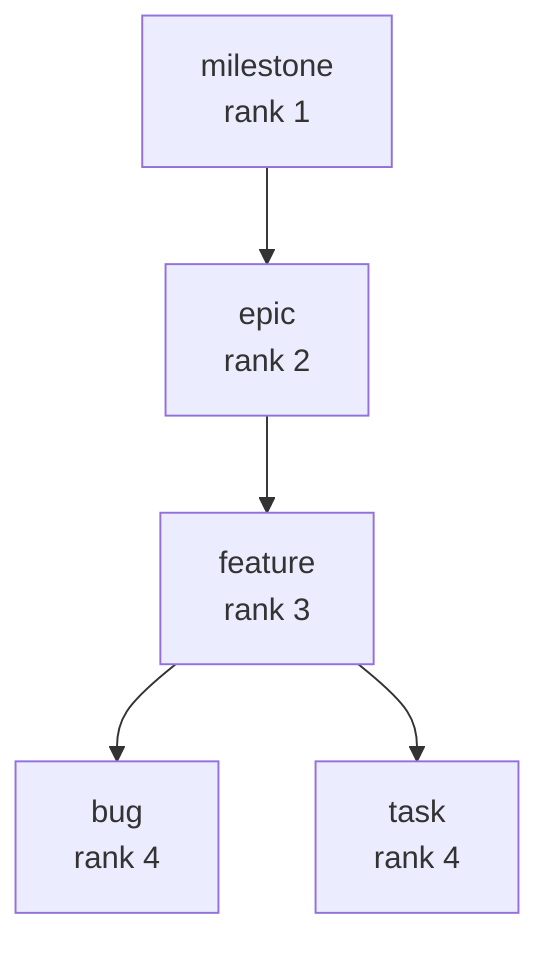

import { Aside } from '@astrojs/starlight/components';

**Five ideas explain every Lif backlog.** After this page you can read any item file and predict what `lif next` returns. The model: *a backlog is a folder of Markdown files, and each file is an item with a type, a status and links to other items.*

## How it looks

One item is one Markdown file. This is a real item file from a throwaway project (`lif create`, then `lif update --blocked-by`):

```markdown
---
# ov1-33x3
title: Build reset form
status: todo
type: task
priority: normal
created_at: 2026-10-14T20:08:25Z
updated_at: 2026-10-14T20:08:28Z
parent: ov1-7kfk
blocked_by:
    - ov1-l1b7
---
```

The same project as a tree (`lif list --view tree`, columns shortened):

```text
epic           Login page                    todo       ov1-vlgh
└─ feature     Password reset                todo       ov1-7kfk
   ├─ task     Build reset form              todo       ov1-33x3
   └─ task     Send reset mail               todo       ov1-l1b7
```

<Aside type="tip" title="Why it matters">
You can read and review the whole backlog without Lif, in any editor or in a Git diff.
</Aside>

## 1. Item

An item is one unit of work. It lives in one Markdown file with YAML front matter and a Markdown body. Lif calls that file a Liff. The file name is `<id>--<slug>.md`, and the ID and slug come from the file name, not from the front matter. Lif keeps front matter keys it does not know. The [Item file format](../../reference/item-file-format/) defines the Liff.

## 2. Hierarchy

Every item has a type, and every type has a rank (a whole number). A parent needs a lower rank than its child. The built-in types:

| Type | Rank |
|---|---|
| `milestone` | 1 |
| `epic` | 2 |
| `feature` | 3 |
| `bug`, `task` | 4 |

An item has at most one parent. A child may skip a level: a task can sit directly under an epic. A task under a task is refused:

```text
Error: failed to create item: task items can only have milestone, epic, or feature as parent, not task
```



Views: `lif list --view tree` and `lif roadmap`. Presets and custom types change this table. See [Configuration](../../reference/configuration/).

## 3. Status

Status shows progress: `todo`, `in-progress`, `draft`, `completed` and `scrapped`. A new item is `todo`. Change it with `lif start`, `lif complete`, `lif scrap` or `lif update --status`. `lif archive` moves completed and scrapped items to `archive/`.

## 4. Blocking

`blocked_by` lists the items that must finish first. `blocking` is the same link seen from the other side. Lif stores a link on one item and merges both directions when it reads. An item is blocked while a blocker, or a blocker of one of its parents, is unfinished.

```bash
lif list --is-blocked --quiet    # ov1-33x3
lif list --ready --type task --quiet   # ov1-l1b7
```

After `lif complete ov1-l1b7`, `lif next --type task` returns `ov1-33x3`. [Dependencies](../../features/dependencies/) has the full rules.

## 5. Store

The store is the `.lif/` folder of Liff files next to the `.lif.yml` configuration. Git versions it with your code. [Store management](../store-management/) shows how to use one store per project, or share one.

## Limits

- `lif next` and `lif list --ready` also return container items such as epics [g5dn]. Add `--type task` (or `bug`) to get leaf work.
- `lif check` does not check parent ranks. Change types and parents with `lif create` and `lif update`, not by hand in the file.

See [Known limitations](../../known-limitations/) for [g5dn].

## Reference

- Priority, tags, manual order and presets: [Glossary](../../reference/glossary/) and [Configuration](../../reference/configuration/).
- [Item file format](../../reference/item-file-format/), [Dependencies](../../features/dependencies/), [Features](../../features/).
