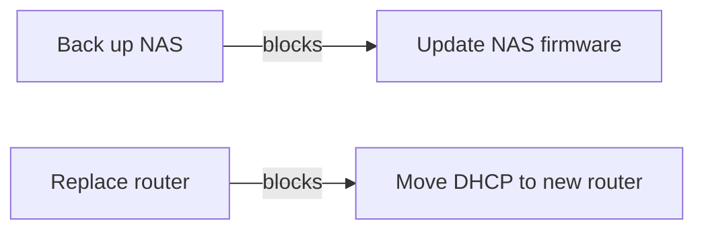

import TerminalWindow from '../../../site/src/components/TerminalWindow.astro';

**See which chores wait on others before you touch a server.** A home lab has many systems and a fixed order: back up first, then update. Put each chore in a file, link the order, and Lif lists what still waits.

<div class="not-content">
<TerminalWindow title="~/homelab" command="lif list --is-blocked" label="Table of two blocked todo tasks: Move DHCP to new router and Update NAS firmware." cols={80} html={`<span style="color:var(--ctp-mauve);font-weight:700">Items</span>
<span style="color:var(--ctp-surface2)">────────────────────────────────────────────────────────────────────────────────</span>
<span style="color:var(--ctp-overlay1)">TYPE  ID        TITLE                                                  STATUS  P</span>
task  lab-wcdl  Move DHCP to new router                                <span style="color:var(--ctp-green);font-weight:700">todo  </span>
task  lab-5vqc  Update NAS firmware                                    <span style="color:var(--ctp-green);font-weight:700">todo  </span>

<span style="color:var(--ctp-overlay1)">priority </span><span style="color:var(--ctp-red);font-weight:700">‼</span><span style="color:var(--ctp-overlay1)"> critical · </span><span style="color:var(--ctp-yellow);font-weight:700">!</span><span style="color:var(--ctp-overlay1)"> high · </span><span style="color:var(--ctp-overlay0)">↓</span><span style="color:var(--ctp-overlay1)"> low · </span><span style="color:var(--ctp-overlay0)">→</span><span style="color:var(--ctp-overlay1)"> deferred</span>`} />
</div>

Example: a network rebuild with four chores. Updating the NAS firmware waits for the NAS backup. Moving DHCP waits for the new router. Tags `nas` and `router` name the systems.

## Set it up

Define two custom types instead of a preset. A project groups chores. A task is one chore. Lif accepts only these types because `types_exclusive` is on. The preset `todo` already writes that key.

```yaml title=".lif.yml"
types_exclusive: true
types:
  - name: project
    rank: 1
  - name: task
    rank: 4
```

[Configuration](../../reference/configuration/) lists every key. Then create the chores and link the order:

```sh
lif create "Network rebuild" -t project
lif create "Back up NAS" --parent <project-id> --tag nas -p high
lif create "Update NAS firmware" --parent <project-id> --tag nas --blocked-by <backup-id>
```



`lif graph --format mermaid` prints these edges plus the parent edges. [Dependencies](../../features/dependencies/) explains how blocking works.

## Work through it

A blocker releases its dependants only when it is `completed` or `scrapped`. Complete the backup. The firmware chore is now ready:

<div class="not-content">
<TerminalWindow title="~/homelab" command="lif list --ready --tag nas" label="Table with one ready task tagged nas: Update NAS firmware." cols={80} html={`<span style="color:var(--ctp-mauve);font-weight:700">Items</span>
<span style="color:var(--ctp-surface2)">────────────────────────────────────────────────────────────────────────────────</span>
<span style="color:var(--ctp-overlay1)">TYPE  ID        TITLE                                                  STATUS  P</span>
task  lab-5vqc  Update NAS firmware                                    <span style="color:var(--ctp-green);font-weight:700">todo  </span>

<span style="color:var(--ctp-overlay1)">priority </span><span style="color:var(--ctp-red);font-weight:700">‼</span><span style="color:var(--ctp-overlay1)"> critical · </span><span style="color:var(--ctp-yellow);font-weight:700">!</span><span style="color:var(--ctp-overlay1)"> high · </span><span style="color:var(--ctp-overlay0)">↓</span><span style="color:var(--ctp-overlay1)"> low · </span><span style="color:var(--ctp-overlay0)">→</span><span style="color:var(--ctp-overlay1)"> deferred</span>`} />
</div>

`lif next --tag nas` returns the single best chore to do next. `lif pick` selects an item ID by fuzzy search, to put on the command line.

## What you get

- The order of chores is data, not memory. `lif next` never hands you a blocked chore.
- Tags filter by system without a fixed hierarchy: `lif list --tag router`.
- Maintenance notes live as Markdown in the repository, versioned with Git. See [Files in your repo](../../features/files-in-your-repo/).

## Limits

- Lif has no recurring items, no reminders and no monitoring of systems. Keep recurrence and alerts in your scheduler or calendar. Create the item when the chore is due.
- `lif list --ready` also lists the project. Add `-t task` to see chores only `[g5dn]`.
- With custom types, `lif create --help` still names the built-in types `[mgx8]`. Read your types from `.lif.yml`.

All open limits: [Known limitations](../../known-limitations/).

## Reference

- [Dependencies](../../features/dependencies/), [Flexible planning](../../features/project-planning/)
- [`lif list`](../../reference/commands/lif-list/), [`lif next`](../../reference/commands/lif-next/), [`lif graph`](../../reference/commands/lif-graph/), [`lif pick`](../../reference/commands/lif-pick/)
