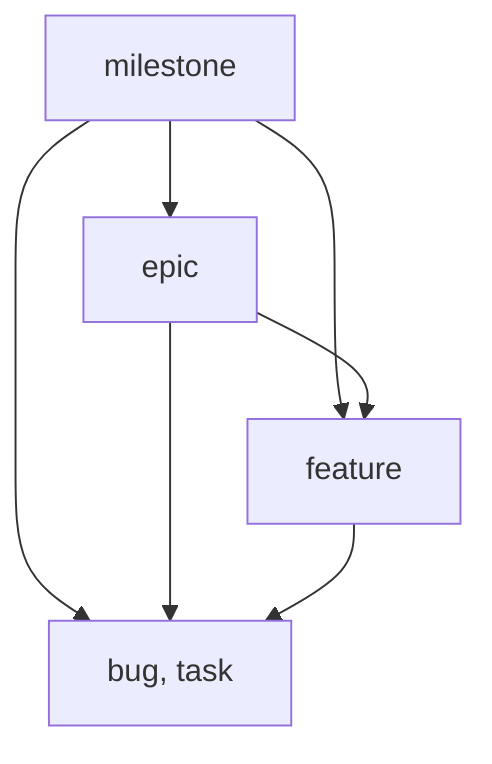

import TerminalWindow from '../../../site/src/components/TerminalWindow.astro';

**Plan milestones, epics and features in the same repository as the code, and read the state of the release with one command.** The `classic` preset gives you four levels. Every item is a Markdown file that travels with your branches.

<div class="not-content">
  <TerminalWindow title="~/notes-app" command={`lif roadmap --depth 2`} html={`<span style="color:var(--ctp-mauve);font-weight:700">Roadmap</span>
<span style="color:var(--ctp-surface2)">────────────────────────────────────────────────────────────────────────────────</span>
<span style="color:var(--ctp-mauve);font-weight:700">M</span>     <span style="color:var(--ctp-mauve);font-weight:700">v1.0 launch</span>                                         <span style="color:var(--ctp-peach);font-weight:700">in-progress</span>     <span style="color:var(--ctp-mauve);font-weight:700">p-rr1n</span>
<span style="color:var(--ctp-surface2)">├─ </span><span style="color:var(--ctp-blue);font-weight:700">E</span>  <span style="color:var(--ctp-blue);font-weight:700">Offline sync</span>                                        <span style="color:var(--ctp-peach);font-weight:700">in-progress</span>     <span style="color:var(--ctp-blue);font-weight:700">p-u9wm</span>
<span style="color:var(--ctp-surface2)">└─ </span><span style="color:var(--ctp-blue);font-weight:700">E</span>  <span style="color:var(--ctp-blue);font-weight:700">Search</span>                                              <span style="color:var(--ctp-green);font-weight:700">todo       </span>     <span style="color:var(--ctp-blue);font-weight:700">p-gi4c</span>

<span style="color:var(--ctp-overlay1)">type     </span><span style="color:var(--ctp-mauve);font-weight:700">M</span><span style="color:var(--ctp-overlay1)"> milestone · </span><span style="color:var(--ctp-blue);font-weight:700">E</span><span style="color:var(--ctp-overlay1)"> epic · </span><span style="color:var(--ctp-sapphire)">F</span><span style="color:var(--ctp-overlay1)"> feature · </span><span style="color:var(--ctp-maroon)">B</span><span style="color:var(--ctp-overlay1)"> bug · </span>T<span style="color:var(--ctp-overlay1)"> task</span>
<span style="color:var(--ctp-overlay1)">priority </span><span style="color:var(--ctp-red);font-weight:700">‼</span><span style="color:var(--ctp-overlay1)"> critical · </span><span style="color:var(--ctp-yellow);font-weight:700">!</span><span style="color:var(--ctp-overlay1)"> high · </span><span style="color:var(--ctp-overlay0)">↓</span><span style="color:var(--ctp-overlay1)"> low · </span><span style="color:var(--ctp-overlay0)">→</span><span style="color:var(--ctp-overlay1)"> deferred</span>`} cols={80} />
</div>

<div class="not-content">
  <TerminalWindow title="~/notes-app" command={`lif progress p-rr1n`} html={`<span style="color:var(--ctp-mauve);font-weight:700">p-rr1n</span> <span style="color:var(--ctp-mauve);font-weight:700">v1.0 launch</span>

<span style="color:var(--ctp-peach);font-weight:700">In Progress</span>: 3
<span style="color:var(--ctp-green);font-weight:700">Todo</span>: 5
<span style="color:var(--ctp-overlay2);font-weight:700">Draft</span>: 0
<span style="color:var(--ctp-overlay1)">Completed</span>: 2
<span style="color:var(--ctp-surface2)">Scrapped</span>: 0
<span style="color:var(--ctp-green)">━━━━</span><span style="color:var(--ctp-surface2)">░░░░░░░░░░░░░░░░</span> 20% complete`} cols={80} />
</div>

A plan in an external tracker drifts away from the code, and an agent in your repository cannot read it. Here the plan is files in the repository, so people, scripts and agents read the same state.

## Example: a notes app with offline sync

Example scenario. The team plans release v1.0 with two epics, "Offline sync" and "Search". "Sync queue" is a feature of the sync epic, and "Conflict resolution" waits for it. The captures above and below come from a throwaway store with this plan after two tasks were finished.

```sh
lif init --profile classic
lif create "v1.0 launch" -t milestone
lif create "Offline sync" -t epic --parent <milestone-id>
lif create "Sync queue" -t feature --parent <epic-id>
lif create "Conflict resolution" -t feature --parent <epic-id>
lif update <conflict-id> --blocked-by <queue-id>
```

`lif progress <milestone-id>` counts every item below the milestone, containers included. Here 2 of 10 items are completed: 20%.

## Structure

`lif init --profile classic` writes this table into `.lif.yml`. A parent must have a lower rank than its children.

| Type | Rank | Short |
|---|---|---|
| `milestone` | 1 | M |
| `epic` | 2 | E |
| `feature` | 3 | F |
| `bug` | 4 | B |
| `task` | 4 | T |



Lif refuses a wrong parent when you create or update an item. If you edit a parent by hand, `lif check` reports it:

```text
✗ item p-7fgw (task) cannot sit under parent p-7umk (task): parent must rank higher
```

Four levels are the rank scale of the preset, not a maximum. See [Configuration](../../reference/configuration/) to add types.

## The loop

```sh
lif next --type task
lif start <id>
lif complete <id> --summary "Format is one JSON line per change."
```

<div class="not-content">
  <TerminalWindow title="~/notes-app" command={`lif next --type task`} html={`task  p-7fgw
Fsync the queue file
<span style="color:var(--ctp-green);font-weight:700">todo</span>  <span style="color:var(--ctp-subtext0)">normal</span>
<span style="color:var(--ctp-overlay1)">parent:</span> <span style="color:var(--ctp-subtext0);font-weight:700">p-w9ml</span>
<span style="color:var(--ctp-overlay1)">created 2026-10-14 20:27 UTC  updated 2026-10-14 20:27 UTC</span>
<span style="color:var(--ctp-surface2)">────────────────────────────────────────────────────────────────────────────────</span>`} cols={80} />
</div>

`lif next` returns the highest-priority item that is ready. `--type task` limits it to leaf work. `lif graph --format mermaid` draws the `blocked_by` links and `lif order <id> --after <id>` sets the order among siblings.

## What you get

- **One plan with the code.** Plan and code live in one repository, in the same branches and commits. See [Files in your repo](../../features/files-in-your-repo/).
- **Progress per container.** Percent is completed items divided by all items except scrapped ones, for any milestone, epic or feature.
- **Order from dependencies.** A blocked parent blocks its children. See [Dependencies](../../features/dependencies/).
- **The same plan for agents.** `lif prime` and `--json` show the agent what you see. See [Automation and agents](../../features/automation/).

## Limits

- Add `--type task` (or `bug`) to `lif next`. Without it, `lif next` can return an epic or a milestone [g5dn].
- Need more than four levels? Add your own types with higher ranks in `.lif.yml`.

See [Known limitations](../../known-limitations/) for [g5dn].

## Reference

- [Flexible planning](../../features/project-planning/), [Dependencies](../../features/dependencies/), [Files in your repo](../../features/files-in-your-repo/)
- [Configuration](../../reference/configuration/), [`lif roadmap`](../../reference/commands/lif-roadmap/), [`lif progress`](../../reference/commands/lif-progress/), [`lif next`](../../reference/commands/lif-next/), [`lif check`](../../reference/commands/lif-check/)
- Next use case: [Release management](../release-management/)
