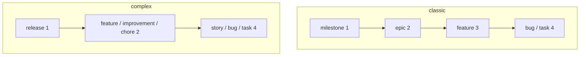

Canonical page for the `.lif.yml` file, for types, ranks and hierarchy rules, and for the shipped presets. It states what Lif enforces on write and what `lif check` verifies. Measured on Lif 0.14, 2026-10-14.

## Config file and discovery

- File name `.lif.yml`. A legacy `.beans.yml` is read in place and never renamed.
- Only one of the two files may exist per directory. Otherwise: `both .lif.yml and .beans.yml exist in <dir>; keep one of them`.
- `--config <path>` loads exactly that file. Otherwise Lif searches from the current directory upward to the filesystem root.
- No file found: built-in defaults, anchored in the current directory.
- Format: YAML. Item settings live under `lif:` (legacy `beans:`; both in one file is an error). The other sections sit at top level.

## Store resolution

Where Lif looks for the store directory, highest priority first:

| # | Source |
|---|---|
| 1 | `--lif-path` |
| 2 | The config file: its `lif.path`, or the default store directory next to it |
| 3 | `LIF_PATH` |
| 4 | The default store directory in the current directory |

- A discovered config file, and only a discovered one, demotes `LIF_PATH`. Reason in the code: variables exported with direnv must not redirect unrelated repositories.
- `LIF_PATH` and legacy `BEANS_PATH` both set is an error. If only the legacy one is set, it is used.
- A relative `lif.path` is resolved against the config directory. An absolute one is used as is.
- `lif.anchor: repo-root`: all Git worktrees of a repository share one store. Without `anchor` a worktree uses its own store. Any other value is a config load error: `unknown lif.anchor "<value>" (expected "repo-root" or an empty value)`.
- Missing directory: `no .lif directory found at <path> (run 'lif init' to create one)`. With an explicit path: `store path does not exist or is not a directory: <path>`. `lif path` prints the result.

The task-oriented view, with worktrees, a shared store and the ID prefix, is [Store management](../../overview/store-management/). This section stays the canonical precedence table.

## Keys and defaults

`lif init` writes a file like this (excerpt, Lif 0.14):

```yaml
project:
    # Human-readable project name (displayed in the UI)
    name: myproject
lif:
    # Directory where item files are stored
    path: .lif
    # Prefix for item IDs (e.g., "myproject-abc1")
    prefix: myproject-
    # Length of the random ID suffix
    id_length: 4
    default_status: todo
    default_type: task
worktree:
    base_ref: main
agent:
    enabled: true
    default_mode: act
server:
    port: 8080
```

| Group | Key | Default |
|---|---|---|
| `project` | `name` | empty (`lif init` writes the directory name) |
| `lif` | `path` | empty = `.lif` |
| | `anchor` | empty; only `repo-root` |
| | `prefix` | empty (`lif init` writes `<directory>-`) |
| | `id_length` | 4 |
| | `default_status` | `todo` |
| | `default_type` | `task` (without `task` in the type table: the first type) |
| | `default_priority` | unset; read only by `lif create -i` |
| | `default_tags` | unset (list of strings); read only by `lif create -i` |
| | `require_if_match` | false |
| | `require_fields_on` | none |
| | `commit_field` | `commit` |
| `worktree` | `base_ref` | `main` |
| | `path` | `~/.lif/worktrees/<project>/`; a leading `~` is expanded. An existing legacy `~/.beans/worktrees/<project>/` is used instead. |
| | `setup`, `run` | empty; `setup` is a shell command run in each new worktree (for example `pnpm install`). Both run with `sh -c` and are outside the [hook trust](#trust): read them in a cloned repository before you create a worktree or start a run in `lif-serve`. |
| | `integrate` | `local` (or `pr`). `local` squash-merges in the local repository and hides the PR buttons; `pr` pushes the branch and opens a PR. |
| | `fetch_timeout` | 10 seconds; 0 disables the fetch |
| `agent` | `enabled` | true |
| | `default_mode` | `act` (or `plan`). `act` runs autonomously, `plan` is read-only. `yolo` is accepted as an alias for `act`; any other value falls back to `act`. |
| | `default_effort` | empty = the tool's own default (`low`, `medium`, `high`, `max`) |
| `server` | `port` | 8080 |
| | `cors_origins` | `http://localhost:*`, `http://127.0.0.1:*`; `*` adds the CORS header for every origin and allows nothing else (pages can read, not change) |
| `display` | `theme` | `mocha` (`latte`, `frappe`, `macchiato`, `mocha`). Colors the CLI output. In the web UI it picks the flavour of the dark scheme (`latte` leaves dark on `mocha`; the light scheme is always `latte`); see [Theme](../web-server/#theme). The TUI uses a fixed dark palette. |
| | `max_width` | 0 = 110; -1 removes the limit; `--max-width` overrides per command. The width never exceeds the terminal width and never falls below 80. |
| `tasks` | `<name>` | none; see [Tasks](#tasks) |
| `hooks` | `<name>` | none; see [Hooks](#hooks) |

`lif.default_priority` and `lif.default_tags` are read only by the guided `lif create -i` form, which pre-fills them. Plain `lif create`, the GraphQL `createItem` mutation and the TUI create form ignore them. `lif check` fails if `default_priority` names an unknown priority (built-in or configured), or if a `default_tags` entry is empty or not a valid tag. An empty list behaves like an unset key.

`lif check` does not validate `lif.default_status`: it prints "Default status exists" without a real test, because the status table is built in. `lif check` reports invalid values for `agent.default_effort` and `display.theme`. The `agent`, `worktree` and `server` keys matter only for [`lif-serve`](../web-server/). Every option that opens the server has no key on purpose: the bind address, the remote terminal and the remote agent, the token and TLS options are flags (`--host`, `--allow-remote-terminal`, `--allow-remote-agent`, `--require-token`, `--public-url`, `--token-file`, `--tls-cert`, `--tls-key`). See [Remote access](../remote-access/).

New worktrees get the branch `lif/<id>`. Worktrees on legacy `beans/` branches are still listed and used.

## Tasks

`lif run` runs named shell tasks. Define them under `tasks:` in `.lif.yml` or in the global file `~/.lif/tasks.yml`:

```yaml
tasks:
    po-accept:
        desc: Accept an item as PO
        args: [id]
        deps: [test]
        steps:
            - '"$LIF" update "$id" --tag accepted'
```

- Schema. A task is a mapping with the keys `desc` (text that `lif run` lists), `args` (required positional arguments), `deps` (tasks that run first) and `steps` (a list of shell scripts). Any other key is an error. A multi-line step is one script. Each step must be a YAML string: `steps: [1, true]` is an error, so quote such a step.
- Validation. A task name uses lowercase letters, digits, `-` and `_`, and starts with a letter or digit. `steps` needs at least one entry, and no step is empty. An argument name uses lowercase letters, digits and `_`, and does not start with a digit. An argument name appears once per task. A dependency name is not empty.
- Global file. `~/.lif/tasks.yml` may contain only the keys `tasks:` and `hooks:`. Any other top-level key is an error. A missing file means no global tasks. The global file is a standard that all your projects share.
- Override. A project task replaces a global task of the same name as a whole. `lif run -g <task>` runs the global one instead. `lif run` lists both files; a project task that hides a global one shows `[project, overrides global]`.
- Dependencies. `deps` resolve against both files, so a global task can depend on a project task. With `lif run -g`, the dependencies resolve in the global file only: a repository cannot run its own task as a dependency of a global task that you asked for with `-g`. A global task that names a project-only dependency fails under `-g`. A dependency runs once, even when several tasks name it. A dependency takes no arguments: a dependency with `args` is an error. A dependency cycle is an error. A global task may depend on a project task of the same name (`deps: [build]` in the global `build` runs the project `build` first): a cycle is a loop of one origin and name.
- Execution. Each step runs with `sh -c` in the project root: the directory of `.lif.yml`, or the current directory when there is none. This needs a POSIX `sh`: Lif takes `sh` from `PATH` and falls back to `/bin/sh`. A multi-line step runs without `set -e`, so a failing command that is not the last one does not stop the step. Start the script with `set -e`, or join the commands with `&&`. A step that starts a background process with `&` can keep `lif run` waiting when the output of `lif run` goes into a pipe (`lif run bg | cat`) until that process ends; redirect the output of the background process, for example `cmd >/dev/null 2>&1 &`.
- Environment. Every step gets `LIF` (path of the lif binary), `LIF_ROOT` (the directory the steps run in), `LIF_TASK` (name of the running task; a dependency has its own name) and `LIF_TASK_ORIGIN` (`project` or `global`). When `--lif-path` or `LIF_PATH` names the store, Lif also sets `LIF_PATH` to its absolute path, so a step that calls `"$LIF"` uses the same store. Each declared argument is also a shell variable, and all arguments are `$1`, `$2`, ... of every step. Everything after the task name goes to the task unparsed.
- Quoting. Quote arguments in the step: `"$id"`. Arguments are shell variables, not text that Lif substitutes into the script.
- Calling tasks. A global task that calls another global task uses `"$LIF" run -g <task>`. Without `-g`, a project task of the same name wins; Lif prints `running project task "<name>" (overrides global; use -g for the global one)` on stderr when it does. `lif run` runs project tasks without a trust check: a `.lif.yml` that you did not write can run commands on your machine. Text from `.lif.yml` that Lif prints (a task `desc`, a gate `message`) is shown without control characters, so an escape sequence in a cloned repository does not reach your terminal.
- Exit code. A failing step stops the run. Lif prints `Error: task "<name>": step <n> of <total> failed (exit code <c>)` and exits with the exit code of that step. Every other failure exits with 1: a step that a signal killed (`step <n> of <total>: signal: terminated`), an unknown task, a missing argument, a cycle or an invalid config. A step that exits with 1 and a refusal by Lif look the same in the exit code; the message on stderr tells them apart. An empty value satisfies a declared argument: check `[ -n "$id" ]` in the step when that matters.
- Listing. `lif run` prints text only, no `--json`. `lif run --json` is an unknown flag, and `lif run <task> --json` passes `--json` to the task. For a machine-readable list use `lif __complete run ""` or read `tasks:` from the files.
- Errors. Errors of `lif run` that are not step failures (unknown task, cycle, invalid config) end with `Run 'lif run --help' for usage.` An unknown task name is case-sensitive and gets no suggestion. `--config <file>` with a file that does not exist is an error (`config file not found`).
- Global tasks and a broken project. `lif run -g` still reads the project `.lif.yml`, so an invalid project config fails it too. Outside a project, or in a worktree without `.lif.yml`, `lif run` lists the global tasks only and gives no hint. Completion (`lif __complete run`) with an invalid project config prints the config error on stderr and offers no task names.
- Signals. While a step runs, SIGINT, SIGTERM and SIGHUP go to the step instead of ending `lif`. `lif` waits for the step, so a `trap` in the step can clean up, and returns the step's exit code. When stdin is not a terminal, the step runs in its own process group and the signal goes to the whole group: no child is orphaned. With a terminal on stdin, the step stays in the foreground group: the terminal sends Ctrl-C to it directly, and `lif` forwards only SIGTERM and SIGHUP to the step itself, not to its children. A step killed by a signal without a `trap` has no exit code: the error shows the signal.
- `lif rename` keeps the `tasks:` block.
- An invalid task makes every lif command in that project fail with the config error, not only `lif run`.

See [Automation](../../features/automation/#tasks) for examples.

## Hooks

A hook runs a [task](#tasks) by itself when an item is created or when one of its fields changes. Tasks are the *what*, hooks are the *when*: a hook adds no commands of its own, so `lif run` and a hook run the same steps the same way. A gate is a hook that runs before the write and can refuse it. `lif hooks` lists every hook and gate, and whether the project hooks run.

Define hooks under `hooks:` in `.lif.yml` or in the global file `~/.lif/tasks.yml`. The name follows the rule of task names. This hook opens a worktree when an item enters `in-progress`, whether it is created that way or changed later:

```yaml
tasks:
  wt-open:
    args: [id]
    steps: ['just -g wt start "$id" milestone/0.16']
hooks:
  open-worktree:
    event: [created, updated]
    changed: [status]
    to: [in-progress]
    type: [feature, task, bug]
    run: wt-open
    args: [id]
```

### Field reference

This table lists every key of a hook. It is a reference, not a template: some keys exclude each other, and a config that sets all of them is invalid.

| Key | Required | Meaning |
|---|---|---|
| `event` | yes | `created` and/or `updated`. The key is `event`, not `on`: a YAML 1.1 tool reads an unquoted `on` as `true`. |
| `run` | yes | Name of the task to run. It is resolved when the hook fires, so a typo shows in `lif hooks`, not at load time. |
| `stage` | no | `after` (default) or `before`. `before` makes the hook a gate. Only valid with `event: [updated]`: a new item has no ID before its write. |
| `changed` | no | At least one of these fields changed. Change filter. |
| `tags_added` | no | At least one of these tags was added. Change filter. |
| `tags_removed` | no | At least one of these tags was removed. Change filter. |
| `from` | no | Status before the change. State filter. Only valid with `event: [updated]`. |
| `to` | no | Status after the change. State filter. |
| `type` | no | Type after the change. State filter. |
| `tags` | no | The item carries at least one of these tags after the change. State filter. |
| `args` | no | Item fields that are passed to the task as arguments, in this order. |
| `message` | no | Fixed text that a blocked change shows. Only valid with `stage: before`. |
| `timeout` | no | Seconds that the task may run. Default 60; `0` means no limit. See [Running hooks](#running-hooks). |

Any other key is an error. In a project config, `from`, `to` and `type` must name known statuses and types. The global file skips that check, because statuses and types differ per project. Tags must be valid tags.

### What matches

- All conditions that a hook sets must hold (AND). The values of one list are alternatives (OR). An OR across different conditions needs two hooks.
- There is no expression language. A condition that needs more than one item, a file or a comparison of values belongs into the task. The script checks and exits 0 when there is nothing to do (after hook) or when the change is fine (gate).
- **Events.** `created` fires once after `lif create`, `lif promote` or the GraphQL mutation `createItem`. `updated` fires after every other change that goes through the write path of the commands and of GraphQL, and only when at least one watched field really changes.
- **Watched fields** are `status`, `type`, `parent`, `tags` and every extra front matter key whose name matches `^[A-Za-z0-9_-]+$`. Lif does not need to know the extra keys in advance. Other extra keys, for example one with a space in its name, are not watched: they are not in `changed`, `args` or the environment. Tags compare as a set, so a reorder is no change. Extra values compare deeply; an added or removed key is a change. A change of title, body, priority, order or blocking links fires nothing.
- **Change filters and state filters.** `changed`, `tags_added` and `tags_removed` filter *what changed*. `from`, `to`, `type` and `tags` filter the *state* before or after the change. For a hook and an after hook, `from` is the state before and `to`, `type` and `tags` are the state after. A gate also matches `type` and `tags` of the state before, so a change that moves an item out of the type or the tag does not take it out of the gate. A status transition therefore needs `changed: [status]`. A hook with `event: [updated]` and only `to: [completed]` also fires when a completed item later gets a new tag.
- **The before state of `created`.** It is an empty item: `changed` lists every watched field that has a value, all `prev_*` fields are empty, and every tag counts as added. So `event: [created, updated]` with `changed: [status]` and `to: [in-progress]` covers both ways into a status.

### Item fields and environment

`args` names the item fields that the task gets as its arguments. The built-in fields are `id`, `title`, `status`, `type`, `parent`, `tags`, `prev_status`, `prev_type`, `prev_parent`, `prev_tags` and `changed`. Every watched extra key `<key>` also gives `<key>` and `prev_<key>`. A built-in name wins over an extra key of the same name.

- Format. `tags`, `prev_tags` and `changed` are space-separated; a tag cannot contain a space. An extra value is a string as it is, a number or bool as `fmt.Sprint` prints it, a list of scalars space-separated, anything else as JSON. A missing value is the empty string.
- An extra key with an empty YAML value (`target_entry:`) reaches the task as the text `null`, not as an empty string. A test `[ -n "$target_entry" ]` is then true. A key that is missing gives the empty string.
- Environment. On top of the variables of a task (`LIF`, `LIF_ROOT`, `LIF_TASK`, `LIF_TASK_ORIGIN`) the task gets `LIF_NO_HOOKS=1`, `LIF_HOOK` (name), `LIF_STAGE` (`after` or `before`), `LIF_EVENT`, `LIF_CHANGED`, `LIF_ITEM_ID`, `LIF_ITEM_PATH`, `LIF_STATUS`, `LIF_TYPE`, `LIF_PARENT`, `LIF_TAGS` and the `LIF_PREV_STATUS`, `LIF_PREV_TYPE`, `LIF_PREV_PARENT`, `LIF_PREV_TAGS` counterparts. Every watched extra key gives `LIF_FIELD_<NAME>` and `LIF_PREV_FIELD_<NAME>`. `<NAME>` is the key in upper case with every character outside `A-Z` and `0-9` replaced by `_`. When two keys give the same name, the first key in sorted order wins and Lif prints a warning for the other.

### Stages and gates

- **After hook** (`stage: after`, the default). It runs after the change is written and cannot veto it.
- **Gate** (`stage: before`). It runs before the write. A non-zero exit blocks the change and nothing is written. With several targets (`lif complete a b`) the targets before the blocked one stay written, and the error ends with the line `(already written: a)`. A stale `--if-match` fails with `etag mismatch` before the gate runs. A gate task that writes its own item makes the outer write fail with `etag mismatch`; do not write the gated item from a gate. A gate compares an extra key as parsed YAML: `--set nn=5` stores the string `"5"`, so on a hand-written `nn: 5` (an integer) it counts as a change of `nn`.

`message:` is fixed text from the YAML file. Lif inserts nothing into it. The dynamic part comes from the output of the gate task (stdout and stderr), which Lif prints below the message. Without `message:`, only the task output follows the first line. A blocked change of an item command such as `lif complete` looks like this, with exit code 1 and no usage line:

```text
Error: hook "require-target-entry" blocked the change of lif-ab12: Entry missing in the target file.
lif-ab12 not found in docs/RELEASE.md
```

With `--json` the error is on stdout, with the code `POLICY_VIOLATION`:

```json
{
  "success": false,
  "error": "hook \"require-target-entry\" blocked the change of lif-ab12: Entry missing in the target file.\nlif-ab12 not found in docs/RELEASE.md",
  "code": "POLICY_VIOLATION"
}
```

- **Gates fail closed.** A gate that cannot run (unknown task, missing argument, killed by a signal, no `lif` binary for a task that uses `$LIF`) blocks the change with `could not run: <error>`. A global file or trust file that cannot be read blocks every change of a watched field with `hooks could not be loaded: <error> (fix it or set LIF_NO_HOOKS=1)`, also in a project without hooks: a typo in `~/.lif/tasks.yml` therefore stops watched-field changes in every project until you fix it. A trust file that does not parse is repaired by `lif hooks deny` or `lif hooks allow`: they replace it with a notice and drop all allows. A missing file is no error. A typo must not switch a policy off silently.
- **Batches.** With several targets (`lif update`, `start`, `complete`, `scrap`, `tag`), the first blocked target stops the run. Targets before it stay written, and the error ends with `(already written: <ids>)`; under `--json` the written items come with the error. The text error keeps its type: it is still the gate error, with exit code 1.
- **Relation to `require_fields_on`.** [`require_fields_on`](#status-dependent-required-fields) checks that a field has a value. A gate checks anything that a script can check: a file, another item, a value against a list.

### Running hooks

- **Synchronous.** The command waits for its hooks, in `lif-serve` too: the HTTP write timeout is off for `/api/graphql` (see [Web server](../web-server/)). Hook tasks run one at a time in `lif-serve`. A write that matches no hook or gate does not wait for a running hook. A create or write that matches one waits for the running hook, so a slow hook delays the matching writes of every client, and a hung one blocks them until its `timeout:`. A client that disconnects does not cancel a running hook.
- **A failing after hook** prints `warning: hook "<name>" (task "<task>"): <error>` on stderr. The change stays and the command still exits 0, so a caller does not repeat a write that succeeded. The next hook runs.
- **Output.** The output and the warnings of a hook go to stderr of the process that runs it: the terminal, or the log of `lif-serve`. Every output line of an after hook starts with `[<hook name>] ` and has its control characters removed, so a title with a newline cannot forge a log line and an escape sequence cannot clear the terminal. A client of `lif-serve` does not see a failing after hook: the mutation succeeds and the warning is only in the log. A client that drops the connection does not stop a running hook: it runs to its `timeout:` and holds the hook lock meanwhile. The TUI drops the stderr of a successful action; a gate block still reaches it, because the TUI reads the JSON envelope (`POLICY_VIOLATION`).
- **Timeout.** A hook or gate task runs at most `timeout:` seconds, default 60, `0` for no limit. At the limit Lif kills the task and its process group. On Windows only the `sh` process is killed, not its children. A gate that times out blocks the change with `could not run: ... timed out after <n>s` (fail closed); an after hook prints a warning and the next hook runs.
- **Output limit.** Lif keeps the first 64 KiB of the output of a hook or gate task and drops the rest; the output ends with `(output cut after 64 KiB)`. The task is not stopped by it. The error of a blocked gate carries only the first 8 KiB of the output (`(output cut after 8 KiB)`) without control characters, because it reaches every client of `lif-serve`.
- **Environment.** A hook or gate task gets the whole environment of the process that runs it, plus the `LIF_*` variables. For `lif-serve` that is the environment of the shell that started it, tokens in it included. A gate that prints its environment shows it to every client that triggers the gate.
- **No chaining.** A `lif` command inside a hook or gate task fires no hooks and no gates: the task gets `LIF_NO_HOOKS=1` and `LIF_HOOK_DEPTH`. As a second brake, a `lif` call with `LIF_HOOK_DEPTH` of 3 or more fires nothing and warns, so a hook that clears `LIF_NO_HOOKS` (`env -u`, an empty value) stops after 3 levels. A call that clears the whole environment (`env -i`, `sudo`, `ssh`, `docker exec`) loses both variables and is not covered: do not call `lif` that way from a hook.
- **No HTTP callbacks to `lif-serve`.** `LIF_NO_HOOKS` belongs to the process, so a task that calls the `lif-serve` API (for example with `curl`) does not inherit it: the server fires hooks for that write. When it matches a hook, it waits for the running hook, which waits for the call: a deadlock that ends at the `timeout:` of the hook. Give such a call `--max-time` and use `"$LIF"` instead.
- **Global hooks run only global tasks.** A global task that calls another global task uses `"$LIF" run -g <task>`: without `-g` a project task of the same name wins, and `lif run` does not check trust. In `lif-serve`, `$LIF` is the `lif` next to `lif-serve`, else the one on `PATH`.
- **Reload.** `lif-serve` reads `.lif.yml` at start: restart it after you edit hooks or tasks. Lif checks the file on disk before every mutation: when its hooks and tasks no longer match what `lif-serve` read at start (for example after `git pull`), the project after hooks do not run, and every project gate that `lif-serve` knows blocks the changes it watches with `<path> changed since this process started; restart it to apply the new config`, until you restart `lif-serve`. `lif hooks allow` does not lift this block: the gates stay on, never off. A gate that you removed from the file stays on too until the restart. A step that runs `"$LIF" run <task>` reads the file again, so the allow of the old content must not carry over. It reads the global file and the trust file on every mutation.
- **Order.** Hooks run in name order, global and project hooks mixed. A hook that writes an item changes what the next hook sees.
- **A stale item after a hook.** After an after hook ran for an item, Lif reads that item's file again: the item that the command prints (the `updateItem` result in `lif-serve`) and its ETag are what the task left on disk. Other items that the task wrote stay stale in memory until the file watcher of `lif-serve` reads them (the CLI watches no files): a following `--if-match` on them gets `CONFLICT`; read the item again with `lif show --json`. A later target of the same batch that the hook wrote fails with `CONFLICT` and is not overwritten. `lif-serve` has one resolver for all requests, and the effect lasts for its whole life: once a hook has run, every later write without `If-Match` expects the ETag that it read, and fails with `CONFLICT` (`etag mismatch: provided <hex>, current is <hex>`, a value the client never sent) when the item changed in between, for example by a parallel write, instead of the last write winning. Restart `lif-serve` to reset it.
- **`lif create --order`.** The order goes into the write that creates the item, so a `created` hook that writes its own item causes no `CONFLICT`.
- **Environment size.** Every watched extra key is exported twice, as `LIF_FIELD_<KEY>` and `LIF_PREV_FIELD_<KEY>`, for every hook of the item, whether the hook reads it or not. The operating system limits the size of an environment (about 1 MB on macOS). A hook of an item with a very large extra value (hundreds of kilobytes) fails with `argument list too long`, and a NUL byte in a value fails with `environment variable contains NUL`: the change stays, the hook prints a warning (a gate fails closed). Keep large content in the body, and read it from the file at `LIF_ITEM_PATH`.
- **Names that clash.** Extra keys `x-y`, `x_y` and `X_Y` all map to `LIF_FIELD_X_Y`: the first in sorted order wins, and lif prints one warning per process and key. `args` uses the real key and has no such clash.
- **Lossy formats.** A list is passed space-separated (the element `"b c"` looks like two elements), a float as `fmt.Sprint` prints it (`2.50` becomes `2.5`), a map as compact JSON, and an absent key and an empty string are both the empty string. A task that needs the exact value reads the front matter of the file at `LIF_ITEM_PATH`.
- **Silent no-ops.** An `args` entry that names no existing extra key gives the empty string. `lif hooks` marks a hook that gives more `args` than its task declares, or that lists a capitalised built-in field (`changed: [Status]` matches only an extra key `Status`), with `(warning: ...)`.
- **`lif rename`** keeps the `hooks:` block.

### Paths that fire nothing

These paths change a watched field and fire no hook and no gate:

- `lif delete` (it clears `parent` of the children)
- `lif check --fix`
- `lif rename` (it rewrites `parent`)
- `lif order` (`order` is not a watched field)
- `saveItem` and `saveDirtyItems` of `lif-serve` (they persist worktree overlays into the main store)
- hand edits of item files and git merges
- creation: a gate has no item before the write, so `lif create -s completed`, `lif promote` and the GraphQL `createItem` can create an item directly in a gated status. A gate on `to: [completed]` does not cover an item that is born completed
- a run with another config or store: the project hooks come from the `.lif.yml` of the working directory, or from the file of `--config`. `--lif-path` and `LIF_PATH` only move the store. A run from another directory, or with `--config` pointing elsewhere, loads no project hook and no project gate, and prints no warning
- a project config that is not allowed, or that was edited after the last `lif hooks allow`: its gates do not run, the change exits 0 and Lif prints one warning on stderr (JSON on stdout carries no warning). Run `lif hooks allow` after every edit of the hooks and tasks, and check the exit of scripts and agents on stderr too

Hooks and gates are therefore not a security boundary. They guard the normal write path.

### `LIF_NO_HOOKS`

`LIF_NO_HOOKS` with any non-empty value, also `0`, skips after hooks and gates. A skipped matching gate prints `warning: gate "<name>" skipped (LIF_NO_HOOKS is set)`. It is a deliberate bypass.

Every process that a hook starts inherits it. An agent session, `lif-serve` or an editor that a hook starts therefore skips all gates for its whole life.

### Trust

A project config can come from a repository that you cloned, so project hooks and gates run only after `lif hooks allow`. Global hooks always run.

- `lif hooks allow` records the fingerprint of the hooks and tasks of this `.lif.yml`. `lif hooks deny` takes the record back. Run `lif hooks allow` yourself after you have read the file: it is your decision, not one for a script or an agent. `lif hooks allow` refuses to run when `LIF_HOOK` is set, that is from inside a hook or gate. `lif hooks --steps` prints the steps of every task that a project hook reaches, quoted so that control characters show; `lif hooks allow` prints the same list. A step that is `!!binary` or contains a bidirectional control character (U+202A to U+202E, U+2066 to U+2069) is a config error.
- **Not allowed.** Lif prints `warning: hooks in <path> are not allowed (<n> gates not enforced); run 'lif hooks allow' to enable them` once per process. The count names the gates, because a gate that is off is a policy that is off. A project that is not allowed never hides a global hook. A project hook replaces a global hook of the same name only when project hooks are allowed. A project hook never replaces a global gate: Lif ignores it, prints `warning: hook "<name>" in <path> ignored: a global gate of that name cannot be replaced; rename it` once per process, and the global gate stays in force.
- **One allow covers all worktrees** of the repository. The key is the path of `.lif.yml` in the main checkout, with symlinks of its directory resolved. For a bare repository (`proj.git` with its worktrees beside it) the main checkout is the bare directory, so repositories that share a parent directory keep separate keys. A directory whose `.git` file names a worktree that is not its own (for example an unpacked archive with a copied `.git` file) is not a checkout of that repository: its key is the path of its own `.lif.yml`. The fingerprint must still match in the worktree that you work in.
- **The fingerprint** covers `hooks` and `tasks` as parsed, so comments and formatting do not change it. It does not cover the scripts that task steps call. Any edit of a task, also one that no hook uses, takes the allow back.
- **Changed file in a running process.** `lif-serve` compares the fingerprint of `.lif.yml` on disk with the one it read at start before every mutation. A step that runs `"$LIF" run <task>` reads the file again, so a changed file takes the allow away until you restart `lif-serve` and run `lif hooks allow`.
- **Not covered.** The fingerprint covers `hooks` and `tasks`. `worktree.setup` and `worktree.run` are not covered and have no trust check: `lif-serve` runs them with `sh -c` when you create a worktree or start a run in the web UI. Read them in a cloned repository before you click. A global hook runs its task in the project root, so a global step such as `make check` or `./scripts/x` runs the repository's own Makefile or script; only the lookup of lif tasks is kept global. Write global steps with absolute paths when that matters.
- **Limits.** If `.lif.yml` itself is a symlink, the key is the path of the link, not of its target. `lif hooks allow` and `deny` hold a lock (`allowed-hooks.yml.lock`) while they update the trust file, so parallel calls do not undo each other, and they write through a symlinked trust file. Entries of moved or deleted repositories stay in the file: a different repository that later lands on the same path with identical hooks and tasks inherits the allow, because scripts are not fingerprinted. An edit that does not change the meaning (for example adding `stage: after`) can still change the fingerprint. Lif does not check the owner or the permissions of `~/.lif/tasks.yml` and the trust file: keep them private. `lif hooks allow` has no confirmation and `lif hooks` has no `--json`. Hook and task names have no length limit. A YAML merge key (`<<`) inside a hook or a task is an error; anchors on whole values work. `event:` must be a list. A global hook with a status that the project does not know is flagged in `lif hooks`, not rejected.

See [Automation](../../features/automation/#hooks) for the worktree example and a gate.

## Statuses, types and priorities

- Built-in statuses: `in-progress`, `todo`, `draft`, `completed`, `scrapped`. Types: `milestone`, `epic`, `feature`, `bug`, `task`. Priorities: `critical`, `high`, `normal`, `low`, `deferred`. See [Item file format](../item-file-format/#allowed-values-and-defaults).
- Entries under `statuses:`, `types:` and `priorities:` override a built-in entry by name or are appended.
- Fields. `statuses`: `name`, `color`, `archive`, `short`, `description`. `types`: `name`, `color`, `rank`, `emphasis`, `roadmap`, `short`, `description`. `priorities`: `name`, `color`, `symbol`, `description`. Omitting `archive` keeps the default of a built-in entry. `lif archive` moves items with an archive status to `archive/`.
- `types_exclusive: true`: `types` is the complete table; built-in types are not added. `lif init --profile` sets it.
- Colors: a Catppuccin tone name or a hex value (`#rgb` or `#rrggbb`, for example `#ff8800`). Tones: `rosewater`, `flamingo`, `pink`, `mauve`, `red`, `maroon`, `peach`, `yellow`, `green`, `teal`, `sky`, `sapphire`, `blue`, `lavender`, `text`, `subtext1`, `subtext0`, `overlay2`, `overlay1`, `overlay0`, `surface2`, `surface1`, `surface0`, `base`. The legacy names `gray`, `grey`, `purple` and `cyan` still work. An empty color is valid. `lif check` reports an invalid one: `✗ invalid color 'notacolor' for type 'spike'`. The web UI applies these colors to badges and borders too, see [Web UI](../web-server/#web-ui).
- Blocking logic: "resolved" means `completed` or `scrapped`, fixed. The flag `archive: true` does not count there, so an item in a custom archive status keeps blocking. The ready logic, in contrast, excludes every status with `archive: true`.

### Recipes

Add a status and a type, set colors. Verified with `lif check` and `lif create` (Lif 0.14):

```yaml
statuses:
    - name: review
      color: "#ff8800"
      description: Waiting for review
    - name: shipped
      color: green
      archive: true
types:
    - name: spike
      rank: 3
      color: teal
      description: Time-boxed research
```

```sh
lif check
lif create "Try it" -t spike -s review
```

To rename a type, add the new type, then change the old items: `lif update <id> -t <new-type>`. Lif does not rename types in existing files.

## Types, ranks and hierarchy rules

- Every type has an integer `rank`. A parent is valid if the child's rank is **strictly greater** than the parent's. Types of equal rank do not nest. "Level" is only a prose synonym for rank.
- Ranks 1 to 3 are container ranks, rank 4 is the leaf rank. A type without `rank` gets 4, an unknown type counts as 4. Gaps are allowed. Container ranks also decide what is ready: `lif next` and `lif list --ready` never return an item whose type sits on rank 1 to 3.
- Depth: the built-in types and the preset `classic` have four levels (`milestone` > `epic` > `feature` > `bug`/`task`). Custom types can go deeper; there is no upper limit (ranks 5 to 7 were accepted). "Four levels" describes the built-in scale, not a maximum.
- Enforced on write: on `lif create --parent`, `lif update --parent`, `lif update --type` and the GraphQL mutations `createItem`, `updateItem`, `setParent`. The CLI, GraphQL and the TUI go through the same checks. Errors:

```text
parent item not found: <id>
<type> items cannot have a parent
<type> items can only have <a, b, or c> as parent, not <type>
would create cycle: [...]
```

- A type change checks both directions (since 0.14): the parent must allow the new type, and every child must be allowed under it. `lif update` checks every target before it writes the first one. Example: `Error: <id>: task items cannot be a child of task items (child <id>)`.
- Manual edits (`parent:`, `type:`, `status:`, `blocking:`) are accepted on load. `lif check` finds them afterwards.

### What `lif check` verifies

| Verified | Not verified |
|---|---|
| Configuration: default type, default priority and tags, colors, theme, effort, prefix consistency | Duplicate IDs |
| Type of every item against the type table | Front matter syntax beyond loading |
| Status and priority values, tag format | |
| File name against the ID the file records in its `# <id>` line, with the links that dangle (a hand rename, since 0.15) | |
| Parent of the wrong type rank: `✗ item <id> (epic) cannot sit under parent <id> (task): parent must rank higher` | |
| Broken links, self-references, cycles in `parent`, `blocking`, `blocked_by` | |
| Orphaned `attachments/<id>` directories | |
| Required fields and commit SHAs (warnings) | |

## Presets

A preset is a type table that `lif init --profile <name>` writes once into `.lif.yml`. The file does not refer to the preset name afterwards. `lif init --profile` sets `types_exclusive: true` and the default type `task`. A preset changes only the type table; statuses and priorities stay the built-in ones. An unknown name gives `unknown profile "<x>" (must be classic, complex, simple, todo)`.

`roadmap: false` on a type hides it from `lif roadmap` and `lif milestones`. On a container rank the whole subtree disappears.

| Preset | Types (rank) | Levels |
|---|---|---|
| `classic` | `milestone` (1), `epic` (2), `feature` (3), `bug` (4), `task` (4) | 4 |
| `todo` | `task` (4) | 1 |
| `simple` | `milestone` (1), `bucket` (1, `roadmap: false`), `epic` (2), `feature` (2), `bug` (4), `task` (4) | 3 |
| `complex` | `release` (1), `bucket` (1, `roadmap: false`), `feature` (2), `improvement` (2), `chore` (2), `story` (4), `bug` (4), `task` (4) | 3 |



## Status-dependent required fields

- `lif.require_fields_on` maps a status to a list of extra keys. An unknown status, an empty field name or a reserved field name is a config load error. Reserved: `title`, `status`, `type`, `priority`, `tags`, `created_at`, `updated_at`, `order`, `parent`, `blocking`, `blocked_by`.
- Writing an item into such a status without a non-empty value for every key fails on `create` and `update` with error code `POLICY_VIOLATION`.
- `lif complete` into such a status fails and names the missing field. Satisfy it in the same call with `--commit <ref>` or `--set key=value`. The check runs before anything is saved.
- `lif check` reports it as a warning in the section "Policy". With `--strict` the warning counts as a finding (exit code 1).
- "Missing" means: key absent, null, or only whitespace.
- `lif.commit_field` (default `commit`) is the extra key that holds a Git SHA. `lif complete --commit <ref>` writes it. `lif check` verifies that the repository knows it (otherwise a warning; without a Git repository the check is skipped).

```yaml
lif:
  require_fields_on:
    completed: [commit]
```
