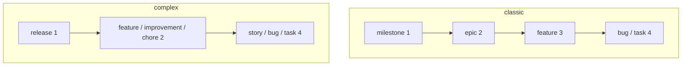

Canonical page for the `.lif.yml` file, for types, ranks and hierarchy rules, and for the shipped presets. It states what Lif enforces on write and what `lif check` verifies. Measured on Lif 0.14, 2026-10-14.

## Config file and discovery

- File name `.lif.yml`. A legacy `.beans.yml` is read in place and never renamed.
- Only one of the two files may exist per directory. Otherwise: `both .lif.yml and .beans.yml exist in <dir>; keep one of them`.
- `--config <path>` loads exactly that file. Otherwise Lif searches from the current directory upward to the filesystem root.
- No file found: built-in defaults, anchored in the current directory.
- Format: YAML. Item settings live under `lif:` (legacy `beans:`; both in one file is an error). The other sections sit at top level.

## Store resolution

Where Lif looks for the store directory, highest priority first:

| # | Source |
|---|---|
| 1 | `--lif-path` |
| 2 | The config file: its `lif.path`, or the default store directory next to it |
| 3 | `LIF_PATH` |
| 4 | The default store directory in the current directory |

- A discovered config file, and only a discovered one, demotes `LIF_PATH`. Reason in the code: variables exported with direnv must not redirect unrelated repositories.
- `LIF_PATH` and legacy `BEANS_PATH` both set is an error. If only the legacy one is set, it is used.
- A relative `lif.path` is resolved against the config directory. An absolute one is used as is.
- `lif.anchor: repo-root`: all Git worktrees of a repository share one store. Without `anchor` a worktree uses its own store. Any other value is a config load error: `unknown lif.anchor "<value>" (expected "repo-root" or an empty value)`.
- Missing directory: `no .lif directory found at <path> (run 'lif init' to create one)`. With an explicit path: `store path does not exist or is not a directory: <path>`. `lif path` prints the result.

The task-oriented view, with worktrees, a shared store and the ID prefix, is [Store management](../../overview/store-management/). This section stays the canonical precedence table.

## Keys and defaults

`lif init` writes a file like this (excerpt, Lif 0.14):

```yaml
project:
    # Human-readable project name (displayed in the UI)
    name: myproject
lif:
    # Directory where item files are stored
    path: .lif
    # Prefix for item IDs (e.g., "myproject-abc1")
    prefix: myproject-
    # Length of the random ID suffix
    id_length: 4
    default_status: todo
    default_type: task
worktree:
    base_ref: main
agent:
    enabled: true
    default_mode: act
server:
    port: 8080
```

| Group | Key | Default |
|---|---|---|
| `project` | `name` | empty (`lif init` writes the directory name) |
| `lif` | `path` | empty = `.lif` |
| | `anchor` | empty; only `repo-root` |
| | `prefix` | empty (`lif init` writes `<directory>-`) |
| | `id_length` | 4 |
| | `default_status` | `todo` |
| | `default_type` | `task` (without `task` in the type table: the first type) |
| | `default_priority` | unset; read only by `lif create -i` |
| | `default_tags` | unset (list of strings); read only by `lif create -i` |
| | `require_if_match` | false |
| | `require_fields_on` | none |
| | `commit_field` | `commit` |
| `worktree` | `base_ref` | `main` |
| | `path` | `~/.lif/worktrees/<project>/`; a leading `~` is expanded. An existing legacy `~/.beans/worktrees/<project>/` is used instead. |
| | `setup`, `run` | empty; `setup` is a shell command run in each new worktree (for example `pnpm install`) |
| | `integrate` | `local` (or `pr`). `local` squash-merges in the local repository and hides the PR buttons; `pr` pushes the branch and opens a PR. |
| | `fetch_timeout` | 10 seconds; 0 disables the fetch |
| `agent` | `enabled` | true |
| | `default_mode` | `act` (or `plan`). `act` runs autonomously, `plan` is read-only. `yolo` is accepted as an alias for `act`; any other value falls back to `act`. |
| | `default_effort` | empty = the tool's own default (`low`, `medium`, `high`, `max`) |
| `server` | `port` | 8080 |
| | `cors_origins` | `http://localhost:*`, `http://127.0.0.1:*`; `*` adds the CORS header for every origin and allows nothing else (pages can read, not change) |
| `display` | `theme` | `mocha` (`latte`, `frappe`, `macchiato`, `mocha`) |
| | `max_width` | 0 = 110; -1 removes the limit; `--max-width` overrides per command. The width never exceeds the terminal width and never falls below 80. |

`lif.default_priority` and `lif.default_tags` are read only by the guided `lif create -i` form, which pre-fills them. Plain `lif create`, the GraphQL `createItem` mutation and the TUI create form ignore them. `lif check` fails if `default_priority` names an unknown priority (built-in or configured), or if a `default_tags` entry is empty or not a valid tag. An empty list behaves like an unset key.

`lif check` reports invalid values for `agent.default_effort` and `display.theme`. The `agent`, `worktree` and `server` keys matter only for [`lif-serve`](../web-server/). The bind address and the remote terminal have no key on purpose: they are the flags `--host` and `--allow-remote-terminal`.

New worktrees get the branch `lif/<id>`. Worktrees on legacy `beans/` branches are still listed and used.

## Statuses, types and priorities

- Built-in statuses: `in-progress`, `todo`, `draft`, `completed`, `scrapped`. Types: `milestone`, `epic`, `feature`, `bug`, `task`. Priorities: `critical`, `high`, `normal`, `low`, `deferred`. See [Item file format](../item-file-format/#allowed-values-and-defaults).
- Entries under `statuses:`, `types:` and `priorities:` override a built-in entry by name or are appended.
- Fields. `statuses`: `name`, `color`, `archive`, `short`, `description`. `types`: `name`, `color`, `rank`, `emphasis`, `roadmap`, `short`, `description`. `priorities`: `name`, `color`, `symbol`, `description`. Omitting `archive` keeps the default of a built-in entry. `lif archive` moves items with an archive status to `archive/`.
- `types_exclusive: true`: `types` is the complete table; built-in types are not added. `lif init --profile` sets it.
- Colors: a Catppuccin tone name or a hex value (`#rgb` or `#rrggbb`, for example `#ff8800`). Tones: `rosewater`, `flamingo`, `pink`, `mauve`, `red`, `maroon`, `peach`, `yellow`, `green`, `teal`, `sky`, `sapphire`, `blue`, `lavender`, `text`, `subtext1`, `subtext0`, `overlay2`, `overlay1`, `overlay0`, `surface2`, `surface1`, `surface0`, `base`. The legacy names `gray`, `grey`, `purple` and `cyan` still work. An empty color is valid. `lif check` reports an invalid one: `✗ invalid color 'notacolor' for type 'spike'`.
- Blocking logic: "resolved" means `completed` or `scrapped`, fixed. The flag `archive: true` does not count there, so an item in a custom archive status keeps blocking. The ready logic, in contrast, excludes every status with `archive: true`.

### Recipes

Add a status and a type, set colors. Verified with `lif check` and `lif create` (Lif 0.14):

```yaml
statuses:
    - name: review
      color: "#ff8800"
      description: Waiting for review
    - name: shipped
      color: green
      archive: true
types:
    - name: spike
      rank: 3
      color: teal
      description: Time-boxed research
```

```sh
lif check
lif create "Try it" -t spike -s review
```

To rename a type, add the new type, then change the old items: `lif update <id> -t <new-type>`. Lif does not rename types in existing files.

## Types, ranks and hierarchy rules

- Every type has an integer `rank`. A parent is valid if the child's rank is **strictly greater** than the parent's. Types of equal rank do not nest. "Level" is only a prose synonym for rank.
- Ranks 1 to 3 are container ranks, rank 4 is the leaf rank. A type without `rank` gets 4, an unknown type counts as 4. Gaps are allowed. Container ranks also decide what is ready: `lif next` and `lif list --ready` never return an item whose type sits on rank 1 to 3.
- Depth: the built-in types and the preset `classic` have four levels (`milestone` > `epic` > `feature` > `bug`/`task`). Custom types can go deeper; there is no upper limit (ranks 5 to 7 were accepted). "Four levels" describes the built-in scale, not a maximum.
- Enforced on write: on `lif create --parent`, `lif update --parent`, `lif update --type` and the GraphQL mutations `createItem`, `updateItem`, `setParent`. The CLI, GraphQL and the TUI go through the same checks. Errors:

```text
parent item not found: <id>
<type> items cannot have a parent
<type> items can only have <a, b, or c> as parent, not <type>
would create cycle: [...]
```

- A type change checks both directions (since 0.14): the parent must allow the new type, and every child must be allowed under it. `lif update` checks every target before it writes the first one. Example: `Error: <id>: task items cannot be a child of task items (child <id>)`.
- Manual edits (`parent:`, `type:`, `status:`, `blocking:`) are accepted on load. `lif check` finds them afterwards.

### What `lif check` verifies

| Verified | Not verified |
|---|---|
| Configuration: default type, default priority and tags, colors, theme, effort, prefix consistency | Duplicate IDs |
| Type of every item against the type table | Front matter syntax beyond loading |
| Status and priority values, tag format | |
| File name against the ID the file records in its `# <id>` line, with the links that dangle (a hand rename, since 0.15) | |
| Parent of the wrong type rank: `✗ item <id> (epic) cannot sit under parent <id> (task): parent must rank higher` | |
| Broken links, self-references, cycles in `parent`, `blocking`, `blocked_by` | |
| Orphaned `attachments/<id>` directories | |
| Required fields and commit SHAs (warnings) | |

## Presets

A preset is a type table that `lif init --profile <name>` writes once into `.lif.yml`. The file does not refer to the preset name afterwards. `lif init --profile` sets `types_exclusive: true` and the default type `task`. A preset changes only the type table; statuses and priorities stay the built-in ones. An unknown name gives `unknown profile "<x>" (must be classic, complex, simple, todo)`.

`roadmap: false` on a type hides it from `lif roadmap` and `lif milestones`. On a container rank the whole subtree disappears.

| Preset | Types (rank) | Levels |
|---|---|---|
| `classic` | `milestone` (1), `epic` (2), `feature` (3), `bug` (4), `task` (4) | 4 |
| `todo` | `task` (4) | 1 |
| `simple` | `milestone` (1), `bucket` (1, `roadmap: false`), `epic` (2), `feature` (2), `bug` (4), `task` (4) | 3 |
| `complex` | `release` (1), `bucket` (1, `roadmap: false`), `feature` (2), `improvement` (2), `chore` (2), `story` (4), `bug` (4), `task` (4) | 3 |



## Status-dependent required fields

- `lif.require_fields_on` maps a status to a list of extra keys. An unknown status, an empty field name or a reserved field name is a config load error. Reserved: `title`, `status`, `type`, `priority`, `tags`, `created_at`, `updated_at`, `order`, `parent`, `blocking`, `blocked_by`.
- Writing an item into such a status without a non-empty value for every key fails on `create` and `update` with error code `POLICY_VIOLATION`.
- `lif complete` into such a status fails and names the missing field. Satisfy it in the same call with `--commit <ref>` or `--set key=value`. The check runs before anything is saved.
- `lif check` reports it as a warning in the section "Policy". With `--strict` the warning counts as a finding (exit code 1).
- "Missing" means: key absent, null, or only whitespace.
- `lif.commit_field` (default `commit`) is the extra key that holds a Git SHA. `lif complete --commit <ref>` writes it. `lif check` verifies that the repository knows it (otherwise a warning; without a Git repository the check is skipped).

```yaml
lif:
  require_fields_on:
    completed: [commit]
```
