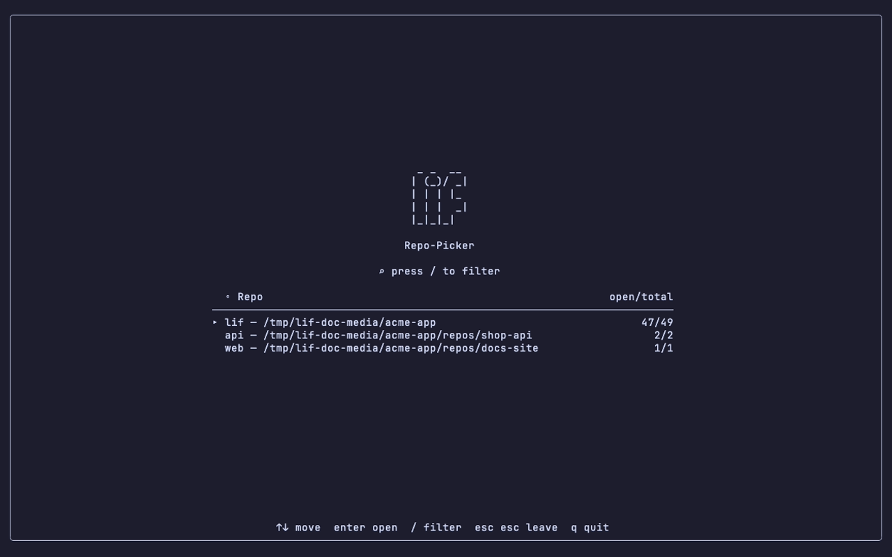
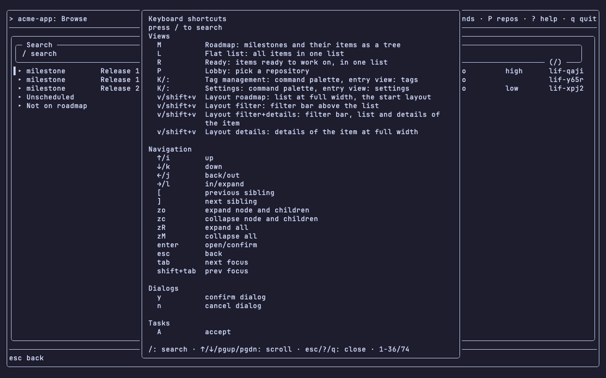
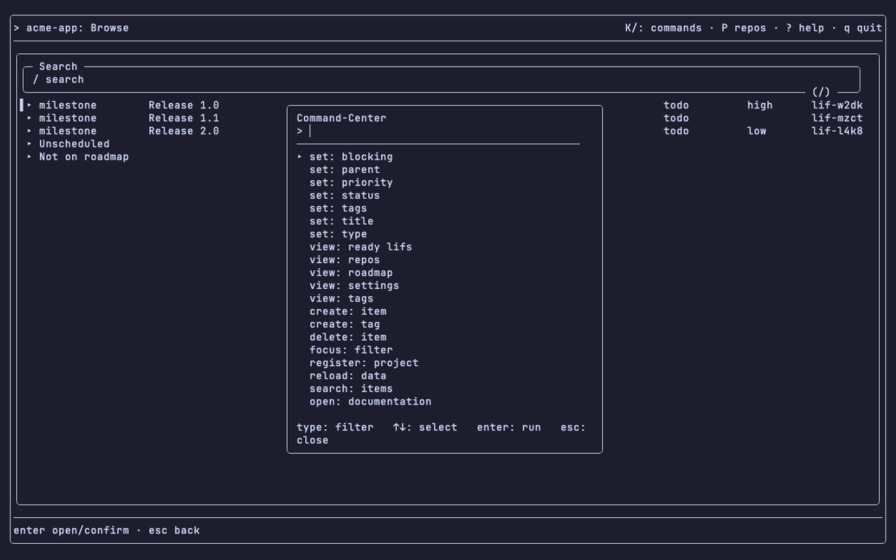

`lif tui` is the terminal UI of Lif, built into the `lif` binary. It is a companion to the CLI: it reads and writes the repository store in the same process; it does not run `lif` as a subprocess. The command page is [`lif tui`](../../commands/lif-tui/).

## Starting the TUI

```sh
lif tui [repo-path]
```

- At most one argument: the repository path. The command has no flags of its own; it honors the global flags `--config` and `--lif-path`.
- The former separate `lif-tui` binary no longer exists.
- `lif tui` finds the repository, opens its store and reads its `.lif.yml`. With the Lobby first, no store is open until you pick a repository.
- The global flag `--lif-path` sets the store, and `--config` sets the `.lif.yml`, of the repository opened at start. They do not apply to a repository you switch to later in the Lobby; that one resolves its own store and config.

## Which repository opens

Lif decides in this order:

1. The path argument: `lif tui ~/code/app`. It opens exactly that repository and never searches upward.
2. The repository found by searching upward from the current directory. A repository is a directory with `.lif.yml` (or legacy `.beans.yml`).
3. No repository, and at least two entries in `repos` of the [settings file](../settings-and-themes/): the repository picker (lobby).
4. Otherwise an error:

```text
Error: no .lif.yml found above /tmp/outside
Run 'lif tui --help' for usage.
```

With exactly one entry in `repos` and no repository above the current directory, no lobby appears. The error is the same as with no entries.

## The repository picker

The lobby lists the repositories from `repos`: a `lif` banner, a filter field, and one row per repository with the name, the path and `open/total`. `open` counts items with status `todo`, `in-progress` or `draft`; `total` counts all items.

```text
Repo-Picker
▸ projA — /tmp/projA   15/17
  projB — /tmp/projB   4/4
```

- `P` opens the picker from any view, also with fewer than two repositories. The "at least two" rule applies only to startup.
- `↑`/`↓` (or `i`/`k`) move, `enter` opens. `/` opens the filter (substring of the path); only then do typed keys go into it, and `esc` closes it.
- `q` opens the `Quit?` dialog: `y` quits, `n` or `esc` stays in the lobby. `esc` twice leaves the lobby: back to the open repository, or quit when none is open. A key between the two presses cancels the first.
- Config edits made while the TUI runs appear the next time you press `P`.
- After each switch the TUI writes `last_repo` to `state.json`. Nothing reads it back.



## Settings that matter at start

Two keys in `~/.config/lif/tui/config.yaml`:

- `repos`: list of repository paths.
- `repo_store_paths`: maps a `repos` entry to a store path. The TUI passes it as `--lif-path` for that repository.

A repository enters `repos` in one of three ways. There is no automatic discovery.

- By hand in the file.
- Command palette (`K`), entry `register: project`: adds the current repository. A duplicate shows `already registered`.
- Settings form (palette entry `view: settings`), field `repos`, one path per line.

All keys: [Settings and themes](../settings-and-themes/).

## Quit and help

- `q` opens a `Quit?` dialog. `enter` or `y` goes to the lobby first when a repository is configured; in the lobby it quits. `esc` or `n` cancels.
- `ctrl+c` quits at once, without confirmation.
- `?` opens the help overlay, generated from the same key map as [Key bindings](../key-bindings/). The overlay is 54 rows high and is clipped on shorter terminals.
- `K` opens the command palette. Entries are sorted by verb: `set`, `view`, the rest alphabetically, then `open`.




