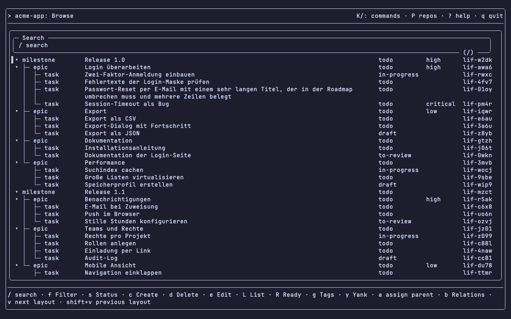
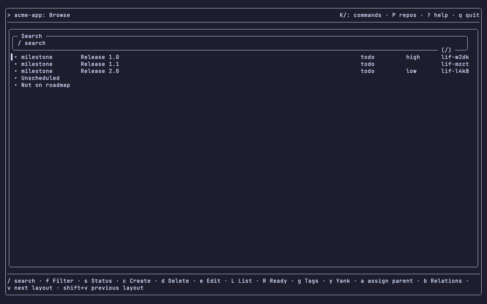
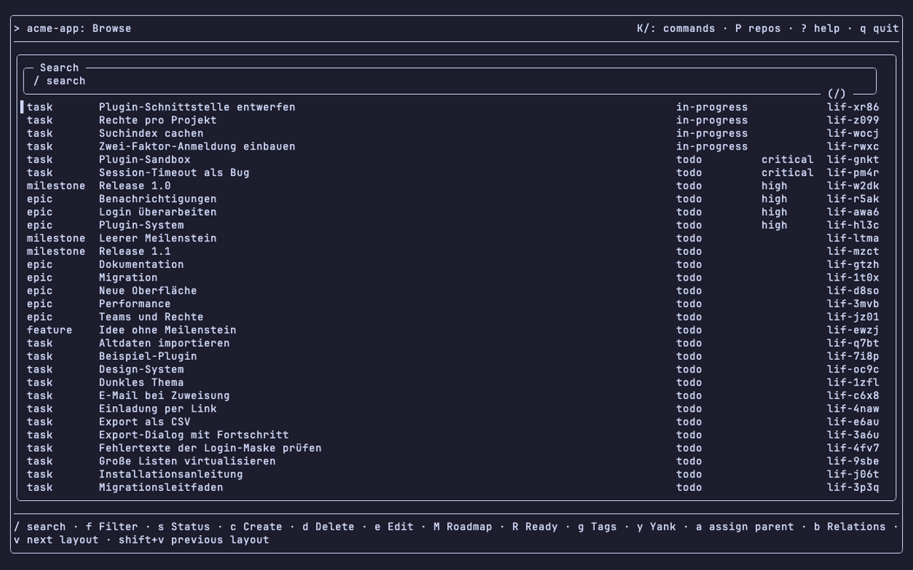
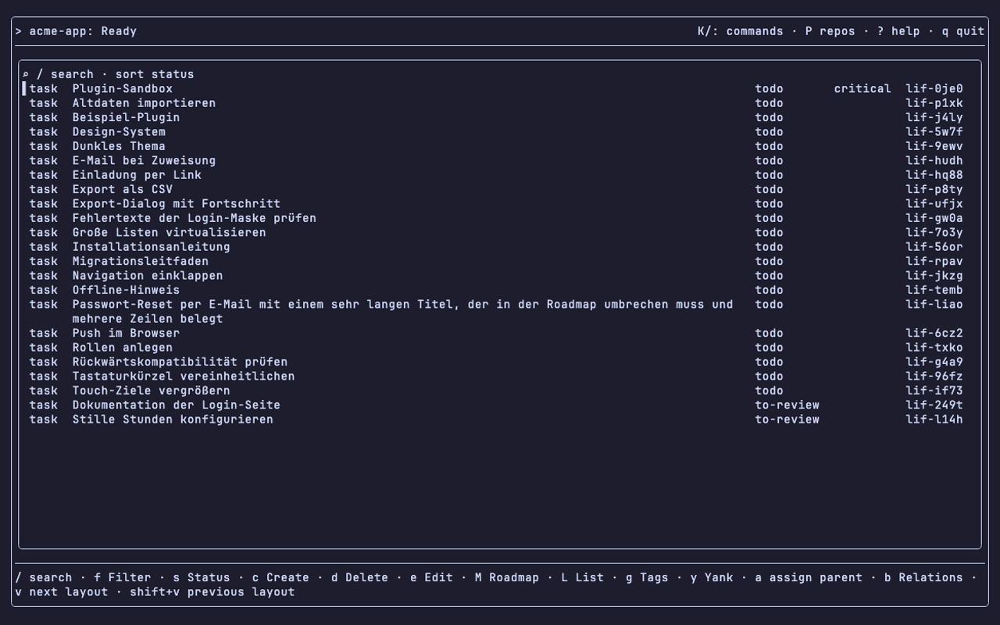
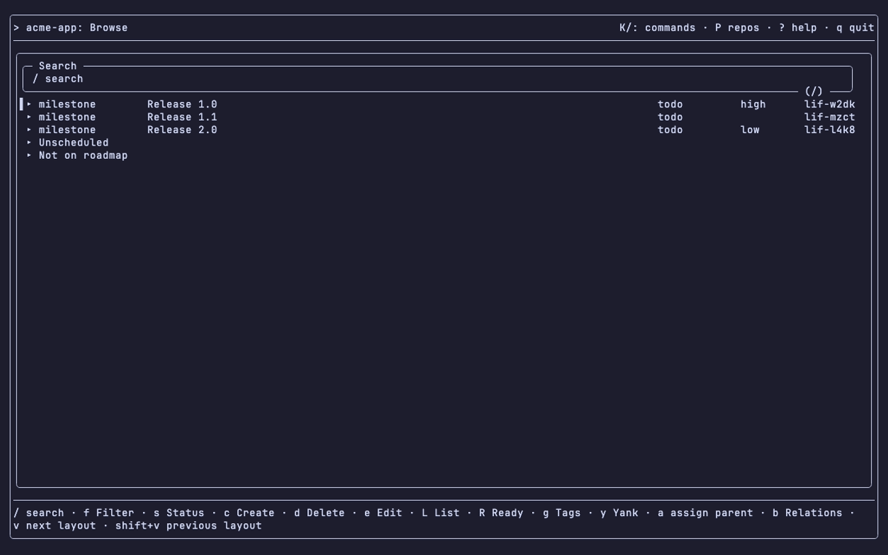
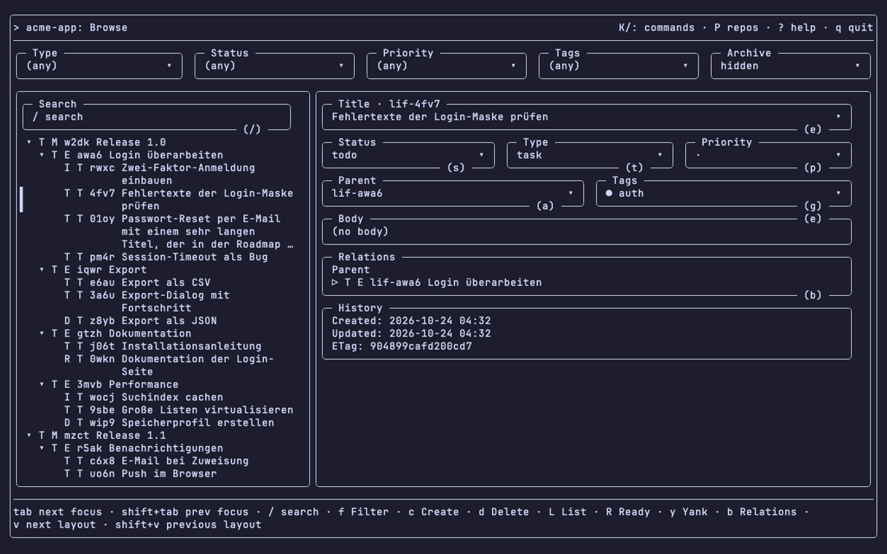
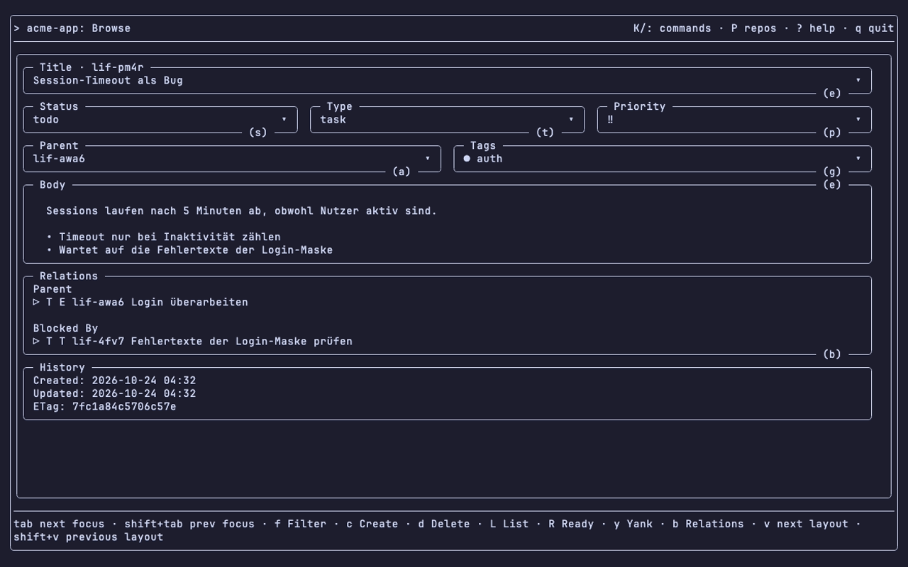
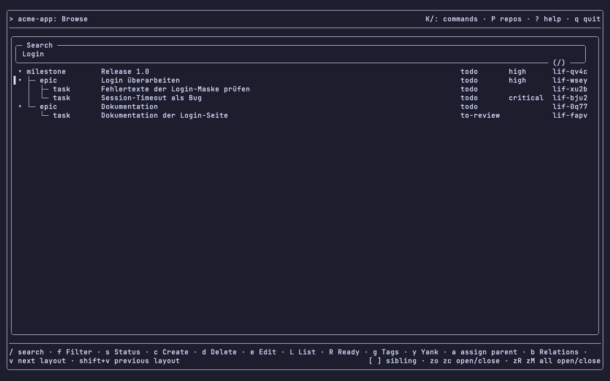

Screenshots from a test repository of 34 items. Key names: [Key bindings](../key-bindings/).

## Overview of the views

There are four views. The item detail is a pane inside Browse and Ready; which panes show is a layout, not a view.

The in-app help (`?`) has a Views section with one line per view and layout and the keys that reach it. This page is the long form. In the help, `/` searches the lines.

| View | Purpose | How to reach it |
|---|---|---|
| Browse, tree | The roadmap: milestones, epics, features, tasks. | Default after start; `M` |
| Browse, flat | All items in one list. | `L` |
| Ready | Items `lif list --ready` lists, flat. | `R` |
| Lobby | Repository picker. | `P` |
| Tag management | Tag definitions. | Command palette `K`, entry `view: tags`. |
| Detail pane | Fields, relations, body of the selected item. Not shown at start. | `v` / `shift+v` change the [layout](#layouts). |

The header reads `> <repo>: <View>`. The focused pane is marked by color only. Hidden by default in tree, flat and ready: `completed` and `scrapped` items. The filter field `Archive` shows them.

## Tree view

- The tree is the roadmap (`lif roadmap`). At start only the milestones and the roots `Unscheduled` and `Not on roadmap` show, all collapsed. Every level is sorted like `lif roadmap`.
- `Unscheduled` holds epics, features and items without a milestone. `Not on roadmap` holds every item the roadmap places nowhere: milestones without children, types with `roadmap: false`, items whose parent does not exist, and members of a parent cycle. Both roots come last.
- The tree pane width is the larger of one third of the screen and `layout.tree_width` (default 36, 24 to 60). At 140 columns it is 46.
- In the layouts Roadmap and Roadmap + filter the tree renders like `lif roadmap`: the same type and status words, wrapped titles, ID on the right, tree lines and colors, at the width of the pane. An item can use several lines; the cursor bar marks all of them, a click on any line selects the item, and scrolling keeps the whole item visible. `▾` and `▸` in the first cell of the line, followed by a gap, left of the tree lines and the type word, show an open and a collapsed node (two cells wider than `lif roadmap`, which has no markers). Only expanded nodes show. The columns are measured over every node, open or not, so opening or closing a node does not move them (`lif roadmap` measures only the rows it prints). Beside the detail pane (layout Roadmap + filter + details) the rows stay compact: one glyph row per item.
- Tree and flat lists have no column header.
- Sorting and menus use the status, type and priority lists of `.lif.yml` in configured order. Values the config does not name sort last.

Closed at start, opened with `zR`:

Moving through the roadmap: `l` opens, `zo` opens a node with its children, `]` and `[` jump between siblings, `zc` closes, `zR` and `zM` open and close everything.

## Flat view

`L` shows the flat list; `M` returns to the Roadmap (nested), and so does `esc` once no search or filter is active. The flat list helps when you search across all items and the hierarchy does not matter. Search and filters apply the same way. Rows look like the roadmap rows without tree lines: type word, title, status word, priority, ID. Beside the detail pane they stay compact (one glyph row per item).

## Ready view

`R` opens it; `esc` clears an active search or filter and then returns to the Roadmap (`M` returns at once). It shows the items `lif list --ready` lists (not blocked, no container types, not `in-progress` or `draft`, not archived, no archived ancestor), flat, in the same rows as the flat view: type word, title, status word, priority, ID; compact beside the detail pane. `v` and `shift+v` cycle the same [layouts](#layouts) as in Browse. `S` cycles the sort: `status`, `priority`, `created`, `updated`, then `status` again. `created` and `updated` sort newest first. Timestamps have one-second resolution. `S` is not in the footer; it appears in the `?` help and as the suffix `· sort <mode>` on the search line.

Switching between the views with `L`, `R` and `M`:

## Layouts

`v` and `shift+v` cycle the layout of Browse (tree and flat) and Ready. `v` goes forward, `shift+v` backward, both wrap. In Ready the Ready list takes the place of the roadmap. The order is:

| Layout | Shows |
|---|---|
| Roadmap | The list at full width. No filter bar, no detail pane. This is the start layout. |
| Roadmap + filter | The filter bar (Type, Status, Priority, Tags, Archive) above the list. |
| Roadmap + filter + details | The filter bar above the list, the detail pane on the right. |
| Details | The detail of the selected item at full width. No filter bar. |

When a layout change leaves the focused region out, focus moves to the list, or to the detail in layout Details. `tab` and `shift+tab` never change the layout.

## Focus ring

`tab` moves focus to the next target, `shift+tab` to the previous one. Both wrap at the ends and never change the layout. Each layout has its own ring:

| Layout | Targets, in order |
|---|---|
| Roadmap | None. `tab` and `shift+tab` do nothing, and the footer does not list them. |
| Roadmap + filter | The list, then the five filter fields. |
| Roadmap + filter + details | The list, the five filter fields, then every detail box (Title to History), one target each. |
| Details | The detail boxes only. |

When focus moves to a detail box, the box cursor moves there and the detail scrolls to keep it visible. `enter` still opens the box. Ready uses the same layouts and rings.

Layout Roadmap + filter + details (`v`): filter bar on top, roadmap left, detail right.

## Detail view

The detail is a box form. The boxes are, from top: `Title · <id>`, `Status (s)`, `Type (t)`, `Priority (p)`, `Parent (a)`, `Tags (g)`, `Body (e)`, `Relations (b)`, `History`. The letter is the key that edits the box.

- While the detail has focus, `↑`/`↓` step through the boxes. `esc` returns to the list (not in layout Details, which has no list). `tab` and `shift+tab` move between the boxes too (see Focus ring).
- `enter` on a box opens its menu, picker or the editor.

## Moving around

- Movement uses the `i/j/k/l` diamond (`i` up, `k` down, `j` left, `l` right) and the arrow keys, not vim keys.
- In the roadmap, `[` and `]` jump to the previous or next item of the same level under the same parent (epic to epic, milestone to milestone), skipping open children; the cursor stays at the first or last one. `zo`/`zc` open or close the cursor item with all its children, `zR`/`zM` open or close every item (`zM` returns to the start state: only milestones and the roots show). These keys do nothing in the flat list and in Ready.
- When the last footer line has room, the roadmap footer shows these keys at its right edge (`[ ]`, `zo zc`, `zR zM`). The block is not shown in the flat list, in Ready, or while a menu or overlay is open.
- `enter` opens, `esc` goes back. `ctrl+r` reloads. `K` opens the command palette.
- The TUI watches the store: a change from another process appears without a key press.
- Mouse: always on. Wheel scrolls the list (or the detail body). A left click selects a row; a second click within 500 ms expands or collapses an item with children. Clicking a detail box opens its editor or picker. A click on a filter field focuses it and opens its value menu; in the open menu a click on a value toggles it and a click outside closes the menu. The mouse is ignored in forms, other overlays, the lobby and tag management. Without a detail pane, a click does not reach the former detail area.

## Search and filters

- `/` starts the search in tree, flat and ready. Each keystroke can trigger a search.
- In the roadmap an active search opens every ancestor of a hit without changing the open and closed state you set; clearing the search brings that state back. Ancestors without a hit of their own are shown muted. The cursor, `[` and `]`, and the mouse only land on hits. `zo`, `zc`, `zR`, `zM` and `←` `→` change the saved state and show their effect once the search is cleared.
- Text of three or more bytes also goes to the same full-text search as `lif list --search`, so [search syntax](../../search-syntax/) applies, including its limits (no `AND`/`OR`/`NOT`). The result is always the union with a local substring match on title and ID: `team` finds `Teams und Rechte`, `Bei*` finds `Beispiel-Plugin` (`*` any run, `?` one character, case-insensitive). An ID substring always matches.
- The TUI splits off its own prefixes before the search: `st:`, `ty:`, `pr:`, `tag:` followed by a value become facet filters (status, type, priority, tag). `tag:auth` in the TUI is a facet, not a search field.
- A bad query shows an error toast, with the error text of the search, for example a syntax error. Incomplete queries such as `title:` flash this while you type.
- The filter bar fields (Type, Status, Priority, Tags, Archive) are focus targets. `f` jumps to the Type field; from layout Roadmap or Details it first switches to layout Roadmap + filter. `←`/`→` (or `j`/`l`) or `tab`/`shift+tab` move between the fields, `enter`, `space` or `↓` open the value menu of the focused field. In the menu `space`, `x` or `enter` toggles a value and the list filters at once; `esc` closes the menu, a second `esc` returns to the list. `X` clears Type, Status, Priority and Tags and keeps the layout. Archive is a view switch, not a facet: `X` leaves it as set. A long Tags list scrolls inside the menu. Facets combine with AND across fields and OR within one.
- The item pickers (`a` and `b`) have chips: `ctrl+t` type, `ctrl+n` status, `ctrl+p` priority, `ctrl+g` tags. They exist only in those two pickers.
