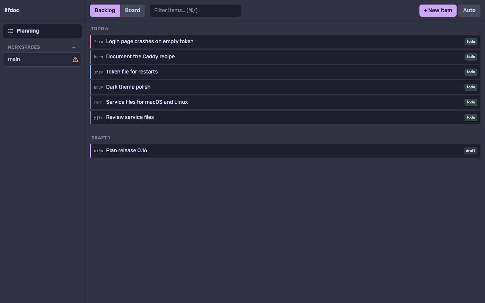

`lif-serve` is a separate binary. It serves the web interface, the GraphQL HTTP API and a terminal WebSocket for one Lif store. The web UI itself was read from the code, not run (frontend not built in the test checkout).

:::caution[Network access, TLS and the terminal [8h4v]]
Since 0.15 `lif-serve` listens on `127.0.0.1` only, so only this machine can reach it. There is **no authentication on loopback**: every local user of the machine can use the port. A web page cannot: the server refuses a request whose `Host` names a host outside the origin list, and a request that changes something when its `Origin` is neither in the list nor the server's own address.

`--host` with another address opens the server to the network. The server then generates an **access token**, prints it at startup and asks every client for it. The terminal, a **shell as the user running `lif-serve`**, stays off unless you add `--allow-remote-terminal`, and agent sessions, which run commands too, stay off unless you add `--allow-remote-agent`. The token travels in clear text unless the server speaks TLS itself (`--tls-cert`, `--tls-key`) or a proxy in front of it does. A reverse proxy in front of a loopback server needs `--public-url` or `--require-token`, else the server refuses what the proxy forwards. The [Remote access](../remote-access/) guide has a recipe for Tailscale, SSH, Caddy and nginx. Tracked as [8h4v] on the [Known limitations](../../known-limitations/) page.
:::

## What lif-serve is

- `lif` itself contains no server. `lif serve` in the `lif` binary is a hidden placeholder that points to `lif-serve` and exits with 1.
- `lif-serve` knows one command, `serve`. Without arguments, or when the first argument starts with `-`, `serve` is added. Aliases: `server`, `s`.
- It loads the store like the CLI and accepts the global flags `--config` and `--lif-path`.

See [Installation](../../overview/installation/) for the binaries and [GraphQL](../graphql/) for the API.

## Starting the server

```sh
lif-serve
lif-serve --port 9090
lif-serve --host 0.0.0.0
```

| Option | Config key | Default |
|---|---|---|
| `--host` | none | `127.0.0.1` |
| `--port`, `-p` | `server.port` | `8080` |
| `--cors-origin` (list; comma-separated or repeated) | `server.cors_origins` | none: only the server's own origin |
| `--allow-remote-terminal` | none | off |
| `--public-url` | none | unset |
| `--require-token` | none | off |
| `--allow-remote-agent` | none | off |
| `--token-file` | none | unset (environment variable `LIF_SERVE_TOKEN`) |
| `--tls-cert`, `--tls-key` | none | unset (plain HTTP) |

`--host` takes an IP address or a host name. The server binds the address first and then looks at what it really got. A loopback address (`127.0.0.1`, `::1`, `127.0.0.2`) keeps the safe defaults, and the server adds that address to the origin list, so its own URL always works. Anything else counts as the network: `0.0.0.0`, `::`, an empty value, a LAN address, a name that resolves to one. The value `tailscale` binds the first IPv4 address of this machine on your tailnet (the address `tailscale status --json` reports as `Self`). It fails with `--host tailscale: Tailscale is not running (state …)` or `--host tailscale: tailscale CLI not found` when it cannot get one. The links in the log then use the MagicDNS name of the machine. All access options (`--host`, `--allow-remote-terminal`, `--allow-remote-agent`, `--require-token`, `--public-url`, `--token-file`, `--tls-cert`, `--tls-key`) have no config key on purpose: a committed `.lif.yml` cannot open the server to the network for everyone who clones the repository.

What the new options do, in short; [Network and CORS](#network-and-cors) has the details and [Remote access](../remote-access/) the recipes:

- `--require-token` asks for the access token on loopback too, and applies the terminal and agent rules of a server on the network. Use it behind a proxy.
- `--public-url <url>` names the address clients use behind a proxy, for example `https://box.tailnet.ts.net/lif`. It implies `--require-token`. The value must be an absolute `http://` or `https://` URL without query or fragment; a trailing `/` is dropped.
- `--allow-remote-agent` serves agent sessions although the server is reachable beyond this machine. Without it the server refuses them (see [Server-only capabilities](#server-only-capabilities)).
- `--token-file <path>` keeps the token across restarts. A missing file is created with mode `0600` and a random token. An existing file must not be readable by group or others (`token file … is accessible by other users (mode 0644); run chmod 600 …`) and must hold at least 32 characters. The environment variable `LIF_SERVE_TOKEN` does the same without a file, with the same length rule; the flag wins. Both apply only when the server asks for a token: on loopback without `--require-token` they are ignored. Together with `--allow-remote-terminal` or `--allow-remote-agent` the server uses a token derived from the stored one (a keyed hash of the two flags), so a token that was valid without the opt-in does not open the server with it.
- `--tls-cert` and `--tls-key` (PEM files, both or neither) serve HTTPS with TLS 1.2 or newer. Plain HTTP to that port is refused with 400.

A flag overrides the config value, which overrides the default. The default is no entry: the server accepts changes and WebSocket upgrades only from its own origin (its address and port, under `localhost` and `127.0.0.1` alike). A given `--cors-origin` **adds** origins to that; a dev server of the UI on another port needs one, for example `--cors-origin http://localhost:5173`. A port wildcard such as `http://localhost:*` lets a page on any local port run changes and open the terminal; see [Network and CORS](#network-and-cors) before you set it. The entry `*` is special, see [Network and CORS](#network-and-cors). See [Configuration](../configuration/).

Startup output with the defaults:

```text
[lif] Listening on 127.0.0.1:8080 (loopback only: reachable from this machine only)
[lif] Starting server at http://127.0.0.1:8080/
[lif] GraphQL Playground: http://127.0.0.1:8080/playground
[lif] Allowed origins: http://localhost:8080, http://127.0.0.1:8080
[lif] Hooks: 2 project hooks (1 gates) active
[lif] Agent: enabled
[lif] Terminal: enabled
```

The `Hooks:` line appears when `.lif.yml` has hooks. It says `OFF` with the reason when they do not run: not allowed yet (`lif hooks allow`, then restart), or `LIF_NO_HOOKS` set. A project hook that is not allowed fails open (the change goes through, the gate is not enforced), so check the line after you edit `.lif.yml`. The web UI and GraphQL show no hook state: there is no query for tasks, hooks or the trust state. A refused write shows its message (a gate block in an alert, the Edit dialog in its error box).

The first line is the address the listener really got [9a66]. With `--host 0.0.0.0` the output is:

```text
[lif] Listening on [::]:8080 (ALL network interfaces: reachable from the network)
[lif] WARNING: anyone who can reach this port and has the access token can read and change items and run agent sessions as the user running lif-serve. There is no TLS, so the token travels in clear text. Prefer the default loopback address with an SSH tunnel or a VPN.
[lif] Access token: <token>
[lif] Open the UI: http://192.168.1.50:8080/?token=<token>
[lif] GraphQL Playground: http://192.168.1.50:8080/playground?token=<token>
[lif] Allowed origins: only this server's own origin
[lif] Agent: disabled (the server is reachable from the network). Add --allow-remote-agent to enable it.
[lif] Terminal: disabled (the server is reachable from the network). Add --allow-remote-terminal to enable it.
```

A listener on all interfaces reports itself as `[::]` (IPv4 and IPv6) where the system has IPv6, and as `0.0.0.0` otherwise. The two address lines name the first LAN IPv4 address of the machine (a VPN address counts; `localhost` when there is none), and with `--host <address>` that address. Open the first one in the browser: it carries the token. The line `Starting server at …` is printed for a loopback listener only, because the address it would name answers 401 without the token. Every `WARNING` line marks a setting that exposes more than the defaults: a listener beyond loopback, a remote terminal, `*` in the origin list. A port that is already taken stops the server at once with `server error: listen tcp 127.0.0.1:8080: bind: address already in use`. SIGINT or SIGTERM prints `Shutting down...` and `Server stopped`. Running requests get 5 s to finish. After a hard deadline of 10 s the process exits anyway with `Shutdown deadline exceeded, forcing exit` on stderr. The access log lines (`[GIN] …`) show the path without the query string, so the token never reaches the log.

Behind a proxy (`--public-url https://box.tailnet.ts.net/lif` on loopback) the server prints an extra line `[lif] Access: token required (--require-token or --public-url)` after the listener line, and the links in the log start with the public URL:

```text
[lif] Listening on 127.0.0.1:8080 (loopback only: reachable from this machine only)
[lif] Access: token required (--require-token or --public-url)
[lif] WARNING: anyone who can reach this port and has the access token can read and change items and run agent sessions as the user running lif-serve. Prefer the default loopback address with an SSH tunnel or a VPN.
[lif] Access token: <token>
[lif] Open the UI: https://box.tailnet.ts.net/lif/?token=<token>
[lif] GraphQL Playground: https://box.tailnet.ts.net/lif/playground?token=<token>
[lif] Allowed origins: http://localhost:8080, http://127.0.0.1:8080, https://box.tailnet.ts.net
[lif] Agent: disabled (the server is reachable from the network). Add --allow-remote-agent to enable it.
[lif] Terminal: disabled (the server is reachable from the network). Add --allow-remote-terminal to enable it.
```

With `--token-file` or `LIF_SERVE_TOKEN` the token line reads `Access token: read from <path or variable>` and the links carry no token: open the address and the server asks for the token (answer 401), or send it as `?token=` yourself. With TLS (`--tls-cert`, or an `https://` public URL) the sentence `There is no TLS, so the token travels in clear text.` is dropped from the warning. A server that starts without the web UI built in (a binary built without `just build`) prints `[lif] WARNING: the web UI is not built into this binary; run just build` first and answers every page with 503 `Web UI not built`.

## Network and CORS

What may use the server depends on the address it listens on.

**On loopback (default)** two checks stand in front of every route. Both read the origin list: the server's own origins plus your `--cors-origin` entries.

- **`Host` header.** A request whose `Host` names a host outside the list gets 403 `host "…" is not allowed`. This stops DNS rebinding: a page of another site makes its name resolve to `127.0.0.1`, so the browser treats the server as that site's own origin. The list gives the host names (`localhost`, `127.0.0.1` and the loopback address the server is bound to, plus those of your entries); the port is not compared.
- **`Origin` header.** A request that can change state, that is any method but GET, HEAD and OPTIONS and every WebSocket upgrade, gets 403 `origin "…" is not allowed` when its `Origin` is neither in the list nor the server's own origin. The server's own origin is `http://` plus the `Host` the request was sent to: the page that `lif-serve` serves comes from there, so the built-in UI needs no `--cors-origin`. `Origin: null` (sandboxed pages) is refused. This stops a page of another site from sending `POST /api/graphql` or opening a WebSocket. Reads are not refused, but the page cannot read the answer: the CORS header goes only to listed origins.
- **No `Origin` at all** passes, so `curl` and scripts keep working, as in the example on [GraphQL](../graphql/). The two checks keep web pages out; they are no protection against a program, which can send any header. The exception is `/api/terminal`: only the web UI uses it and a browser always sends `Origin` on a WebSocket upgrade, so a client without one gets 403 there.
- A `POST /api/graphql` needs `Content-Type: application/json`. Form and `text/plain` posts, the kinds a page can send without a CORS preflight, answer `transport not supported`, and a mutation over GET answers `GET requests only allow query operations`.
- **Default: the server's own origin only.** Without `--cors-origin` (and without `server.cors_origins`) nothing but the page that `lif-serve` serves itself may change items or open a WebSocket. On loopback that page is reachable as `localhost`, `127.0.0.1` or the bound loopback address, each on the port of the server. A request from any other local port, such as a dev server of the UI on `http://localhost:5173`, gets 403 `origin "…" is not allowed`, like a page of another site. Entries of `--cors-origin` are added to the own origins; they do not replace them. An entry matches exactly (`http://localhost:5173`). The pattern `scheme://host:*` matches any port.
- **Risk of a port wildcard.** With `http://localhost:*` (or `http://127.0.0.1:*`) in the list, a page served from any local port can use the server: another local web app, or an XSS hole in one, can change items, which runs the project hooks and gates of `.lif.yml`, and open the terminal (a shell as your user). Do not set it. Name the exact origin of your dev server instead, for example `--cors-origin http://localhost:5173`, and do not open untrusted pages in a browser while `lif-serve` runs on a project with hooks. The startup output shows a `NOTE` while the list has a `:*` entry. Before 0.16 the default list was `http://localhost:*, http://127.0.0.1:*`; a setup that relied on it needs an explicit entry now.
- `--cors-origin '*'` sends `Access-Control-Allow-Origin: *`, so any page can **read** what the server answers: items, workspaces, agent sessions. That is all it does. The host check stays on, a page of another site, or of another local port, still cannot change anything or open a WebSocket or the terminal, and the server's own origins stay allowed. Name the origins that may change things in the list. The server prints a `WARNING` for `*` that names the shell. In 0.14 `*` also let every origin open a WebSocket, the terminal included.

**Beyond loopback** a script can send any header, so the checks above prove nothing against it. The server asks for the access token instead:

- Every request needs the token, the UI and the playground included: as `Authorization: Bearer <token>` for scripts, or in the cookie `lif_token_<port>` for the browser. Without it the answer is 401.
- Open the address printed at startup once (`http://<address>:<port>/?token=<token>`). The server sets the cookie (`HttpOnly`, `SameSite=Lax`, until the browser closes; `Secure` under TLS or an `https://` `--public-url`) and answers 303 with `Location: ./`, which leads to the same page without the token, also under a path prefix a proxy removes. The token is new on every start, unless `--token-file` or `LIF_SERVE_TOKEN` brings one (see [Starting the server](#starting-the-server)). It is in the server log, so protect the log like a password. The cookie name carries the port (`lif_token_<port>`), so servers on one host do not mix.
- The `Host` header does not matter there: the token is the protection.
- The origin check still applies to requests that change state, and the UI the server serves passes it as its own origin: open `http://192.168.1.50:8080/?token=<token>` and no `--cors-origin` is needed.
- A page of another origin cannot use a server on the network, and that is by design. Its preflight carries no credentials and gets 401, and a browser sends neither the cookie nor an `Authorization` header across origins. Only the UI the server serves, and scripts that send the Bearer header, work.
- `/api/terminal` answers 403 `the terminal is disabled…`, and the GraphQL calls `writeTerminalInput`, `startRun` and `stopRun` fail with `terminal support not available`. `--allow-remote-terminal` turns the terminal on; the token is still required.
- Agent sessions are off in the same way: every agent mutation fails with `agent manager not available`, the query `agentEnabled` returns `false`, and the UI hides the Agent button. `--allow-remote-agent` turns them on; the token is still required.
- **TLS.** `--tls-cert` and `--tls-key` make the server speak HTTPS itself. The own origin of the UI is then `https://` plus the `Host`, and the token cookie is `Secure`. Without TLS, or a proxy that ends it, the token travels in clear text beyond loopback.
- **Behind a proxy.** A proxy connects from loopback, so on its own the server sees only local clients. Two flags make it safe. `--require-token` asks for the token on loopback. `--public-url <url>` also names the address clients use: the server adds its origin (`scheme://host[:port]`) to the origin list, which is also the list of host names it answers to, builds the links in the log and the playground endpoint from it, and sets `Secure` on the cookie when the URL is `https://`.
- **A forwarded request without the flag.** On loopback without a token, a request that carries one of the headers `X-Forwarded-For`, `X-Forwarded-Host`, `X-Forwarded-Proto`, `Forwarded` or `Tailscale-User-Login` gets 403 `this request came through a proxy, but lif-serve runs without an access token. Start it with --public-url <url> or --require-token.` Measured: Caddy (`reverse_proxy`) and `tailscale serve` send such a header. nginx adds none by default, so the server cannot detect it: with nginx the flag is mandatory, not a safety net. Tools that connect to loopback directly (`curl`, the UI dev server of the frontend) send none of these headers and keep working.

## Routes

| Path | Content |
|---|---|
| `/api/graphql` | GraphQL over WebSocket, OPTIONS, GET, POST. See [GraphQL](../graphql/). |
| `/playground` | GraphQL Playground. Loads GraphiQL from a CDN, so it needs internet access. |
| `/api/attachments/:beanId/:filename` | Image attachments of the agent chat. `:beanId` is the item ID. |
| `/api/terminal` | WebSocket terminal. Starts `$SHELL` (else `/bin/sh`). Needs an `Origin` header. Off when the server listens beyond loopback or asks for a token (`--require-token`, `--public-url`), unless `--allow-remote-terminal` is given. |
| everything else | The embedded single-page app. A path that names a file gets that file. A path with a `.` that matches no file (a missing `.js` or `.css`) gets a plain 404. A path without `.` gets the prerendered page when `<path>.html` exists (`/planning`), else `index.html`. The page refers to its scripts and to the API by relative paths, so the UI works under a path prefix that a proxy removes before it forwards the request (see [Remote access](../remote-access/)). |

Limits: request body 10 MB, 100 concurrent WebSocket upgrades (then 503), read and write timeout 15 s, idle timeout 60 s. `/api/graphql` has no write timeout: hooks and gates run synchronously inside a mutation, and an after hook can take longer than 15 s. `/api/graphql` subscriptions and `/api/terminal` share the 100 WebSocket slots.

## Web UI

The frontend (SvelteKit) is embedded in the binary. No second server is needed.

- `/planning` is the **Backlog**: two sections, Todo and Draft, with top-level items and their children nested.
- `/planning/board` is the **Board**: three fixed columns Todo, In Progress, Completed. Dragging a card sets `status` and `order`.
- `/workspace/<id>` is the workspace of a Git worktree: agent chat, changes, terminal. It appears only when `agent.enabled` is true. A **Run** button appears when `worktree.run` is set.
- The UI has a filter field (substring over title, type, status, ID, tags). It does not use [search syntax](../search-syntax/).
- The UI keeps layout in `localStorage` under `lif-planning-chat`, `lif-changes-pane`, `lif-filter-text`, `lif-theme`, `lif-dark-flavour` and `lif-split-<panel>`. The selected item is mirrored as `?item=<id>`, so `http://localhost:8080/?item=<id>` is a deep link.
- There is no settings page. The theme button at the right end of the toolbar switches between Auto, Light and Dark; see [Theme](#theme).
- Statuses, types and priorities come from `.lif.yml`: the built-in lists plus your entries, in config order (the order also sorts items, as in the CLI). Badges, card borders and priority labels use the `color` of their entry, a Catppuccin tone name or `#rrggbb`. An entry without a valid colour, and a name the config does not list, gets a neutral grey. The server reads the config at start: restart `lif-serve` after a change and reload the page.
- The Backlog sections (Todo, Draft) and the Board columns (Todo, In Progress, Completed) stay fixed. A top-level item whose status has no section or column, such as `scrapped` or a custom status, is not listed; it appears under its parent and opens from its `?item=<id>` link.



## Theme

The UI uses the [Catppuccin](https://catppuccin.com) palette, the same as the CLI. It has a light and a dark scheme:

- **Light** is always `latte`.
- **Dark** uses the flavour that `display.theme` names in `.lif.yml`: `frappe`, `macchiato` or `mocha` (the default). `latte` or an unknown name leaves the dark scheme on `mocha`. The server reads the key at start: restart `lif-serve` after a change and reload the page.
- The theme button chooses the scheme. **Auto** follows the operating system and changes with it while the page is open; **Light** and **Dark** override it.
- The choice is stored in `localStorage` under `lif-theme`, and the last dark flavour under `lif-dark-flavour`. A small script in the page applies both before the first paint, so a reload does not flash.
- The accent is the mauve of the flavour, as in the CLI. Code blocks and the terminal follow the scheme and the flavour.

The palette is generated from the colour table in `internal/ui/theme.go`: `go generate ./internal/ui` writes `frontend/src/lib/catppuccin.css`, and a test fails when the file is stale. The web UI therefore carries no second copy of the colours.

## Live updates

The server watches the store directory and pushes changes through the `itemChanged` subscription. The source is the file system, so `lif update` in another process and a manual edit of a file both appear without reloading. Measured: a change reached the subscriber about one second later, as `UPDATED`, `CREATED` or `DELETED`. Directories of worktree stores are watched too. The subscription is described on [GraphQL](../graphql/#subscriptions).

## Server-only capabilities

Only `lif-serve` provides worktrees, agent sessions, terminal sessions and starting or stopping the project run command. In `lif graphql` the same mutations fail:

| Call | `lif graphql` | `lif-serve` |
|---|---|---|
| `createWorktree(name:"x")` | `Error: graphql: worktree support not available` | creates a Git worktree |
| `stopAgent(itemId:"...")` | `Error: graphql: agent manager not available` | `true` |
| `writeTerminalInput(...)` | `Error: graphql: terminal support not available` | `true` |

On loopback these calls need no credentials. Beyond loopback, or with `--require-token` or `--public-url`, they need the access token like every other call, and with the terminal off `writeTerminalInput` fails with `terminal support not available`. Agent sessions are refused there as well unless `--allow-remote-agent` is given: every agent mutation then fails with `agent manager not available`, and the UI hides the Agent button (the Changes and Terminal buttons stay). The startup line `Agent: …` tells which case applies. Config keys: `agent.enabled`, `agent.default_mode`, `agent.default_effort`, `worktree.base_ref`, `worktree.path`, `worktree.setup`, `worktree.run`, `worktree.integrate`, `worktree.fetch_timeout`; see [Configuration](../configuration/). `agent.enabled: false` only hides the agent parts of the UI; the server-side agent code stays reachable. An agent session in act mode, the default, runs commands without asking, so a client that can send an agent message can run commands even when the terminal is off. That is why `--allow-remote-agent` is a flag and not a config key. `createWorktree` runs the commands of `worktree.setup` in the new worktree, so it is a way to run commands as well, and it needs only the token.

Shells in workspaces get the environment variable `LIF_WORKSPACE_PORT` (legacy `BEANS_WORKSPACE_PORT`).

## Limits

- Without TLS the access token travels in clear text beyond loopback. Use `--tls-cert` and `--tls-key`, a proxy that ends TLS, or a tunnel [8h4v].
- No authentication on loopback: every local user of the machine, and every program that runs as you, can use the port [8h4v].
- A `--cors-origin` entry with a port wildcard such as `http://localhost:*` lets a page from any local port use the server (see [Network and CORS](#network-and-cors)). The default does not.
- Beyond loopback, and behind a proxy, the terminal pane of the UI cannot connect while the terminal is off and retries every 500 ms.
- `lif serve` in the `lif` binary is only a placeholder.
