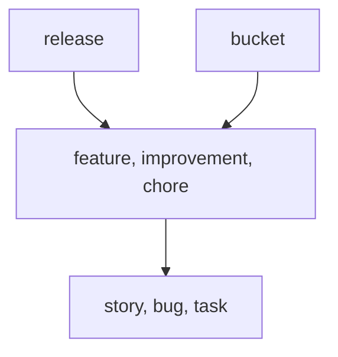

import TerminalWindow from '../../site/src/components/TerminalWindow.astro';

**Close every item with the commit that did the work, and let `lif check` confirm that the commit exists.** The `complex` preset keeps the release apart from the work in it. `lif complete --commit` writes the commit SHA into the item file.

<div class="not-content">
  <TerminalWindow title="~/shop" label="Confirmation that item r-dbho, Export drops rows with commas, is completed." command={`lif complete r-dbho --commit HEAD --summary "Cells are quoted per RFC 4180."`} html={`<span style="color:var(--ctp-green)">Completed </span><span style="color:var(--ctp-subtext0);font-weight:700">r-dbho</span> Export drops rows with commas`} cols={80} />
</div>

<div class="not-content">
  <TerminalWindow title="~/shop" label="The current commit hash and the matching commit field stored in the item file, both 11a0109." command={`git rev-parse HEAD; grep '^commit:' .lif/r-dbho--export-drops-rows-with-commas.md`} html={`11a01091d8d90b717396ea2f5c3b5dfad41e47e1
commit: 11a01091d8d90b717396ea2f5c3b5dfad41e47e1`} cols={80} />
</div>

Without a commit field, you cannot tell which items of a release are done and with which change. Here every completed item carries its SHA, and a release is a subtree with a progress number.

## Example: release 2.3 of a shop

Example scenario. Release 2.3 holds the feature "Export to CSV", the improvement "Faster startup" and the chore "Upgrade Go toolchain". A review found one bug in the export. The captures come from a throwaway store with a real Git repository. The daily loop with `create`, `start` and `progress` is the same as in [Software project](../software-projects/). This page shows only what is new.

### Complex preset

`lif init --profile complex` writes a table of types. Items sit under a `release`, and the work sits under a feature, improvement or chore.

| Type | Rank | Role |
|---|---|---|
| `release` | 1 | A version that ships |
| `bucket` | 1 | A parking lot; `roadmap: false` keeps it out of the roadmap and the milestone list |
| `feature`, `improvement`, `chore` | 2 | Value contributions |
| `story`, `bug`, `task` | 4 | Implementation items |



Rank 3 is unused. The rank rule allows gaps, so the preset has three levels.

## Findings become items

`lif promote` turns selected records of a review artifact into items. A finding with code `B` becomes a `bug`, and code `I` becomes a `task` tagged `improvement`. Lif writes nothing if one selected record is malformed. A finding that was promoted before is skipped, not duplicated:

<div class="not-content">
  <TerminalWindow title="~/shop" label="Message that finding B01 was skipped because it was already promoted from review.json." command={`lif promote review.json B01`} html={`skipped B01: already promoted from review.json`} cols={80} />
</div>

The promoted item records `review`, `finding` and `axis` in its front matter and has no parent. Attach it with `lif update <id> --parent <feature-id>`. The artifact format is not documented yet [nhcz].

## Commit SHAs

By default `lif complete` does not need a commit. Ask for one in `.lif.yml`: this is an addition to the preset, not part of it.

```yaml
lif:
    require_fields_on:
        completed:
            - commit
```

Now `lif complete <id>` without `--commit` is refused:

```text
Error: status "completed" requires front matter field(s) commit: supply them in the same write (e.g. `lif complete r-0c2p --commit HEAD`)
```

`--commit` takes a branch, tag, SHA or `HEAD` and stores the full 40-character SHA. The key is `commit` unless `lif.commit_field` names another. With the requirement in place, `lif check` looks up every stored SHA in the repository. It reports a SHA that does not exist as a policy warning, and `--strict` turns the warning into exit code 1. In this capture the SHA in the item file was changed by hand to one that does not exist:

<div class="not-content">
  <TerminalWindow title="~/shop" label="Result of the strict store check: a list of passed configuration and item checks, each marked with a check mark." command={`lif check --strict`} html={`<span style="font-weight:700">Configuration</span>
  <span style="color:var(--ctp-green)">✓</span> Statuses defined (5 hardcoded)
  <span style="color:var(--ctp-green)">✓</span> Default status 'todo' exists
  <span style="color:var(--ctp-green)">✓</span> Default type 'task' is valid
  <span style="color:var(--ctp-green)">✓</span> Every item carries a known type
  <span style="color:var(--ctp-green)">✓</span> Status, priority, tags and hierarchy are valid
  <span style="color:var(--ctp-green)">✓</span> File names give the IDs the files record
  <span style="color:var(--ctp-green)">✓</span> All status colors valid
  <span style="color:var(--ctp-green)">✓</span> All type colors valid
  <span style="color:var(--ctp-green)">✓</span> Prefix consistency valid

<span style="font-weight:700">Item Links</span>
  <span style="color:var(--ctp-green)">✓</span> No link issues found

<span style="font-weight:700">Policy</span>
  <span style="color:var(--ctp-peach)">!</span> r-dbho: commit 0123456789abcdef0123456789abcdef01234567 not found in this repository

<span style="color:var(--ctp-red)">1 issue found</span>
exit 1`} cols={100} />
</div>

Without `require_fields_on`, `lif check` does not look at the commit field.

## What you get

- **Evidence per item.** The item file names the commit that completed it, and Git versions the item with the code.
- **Findings with provenance.** Promoted items keep the review, the finding and the axis.
- **Release scope as a subtree.** `lif progress <release-id>` gives the percentage for one release. See [Software project](../software-projects/).

## Limits

- Create the Git tag and write the release notes yourself. Lif has no command for either.
- Run `lif check --strict` in your own script or hook, for example before you tag. Lif installs no hook.
- Write the review artifact by reading the schema in the repository, until the format has a page [nhcz].
- `lif promote` can stop part-way through a set [z69m]. Run `lif list` after a failed call to see what was created.
- A promoted item has no parent, so it is outside the release progress. Attach it with `lif update <id> --parent <feature-id>` [tgph].

See [Known limitations](../../known-limitations/) for [nhcz], [z69m] and [tgph].

## Reference

- [`lif complete`](../../reference/commands/lif-complete/), [`lif promote`](../../reference/commands/lif-promote/), [`lif check`](../../reference/commands/lif-check/), [`lif progress`](../../reference/commands/lif-progress/)
- [Configuration](../../reference/configuration/): `complex` preset, `require_fields_on`, `commit_field`
- [Automation and agents](../../features/automation/): run checks from scripts and agents
- Previous use case: [Software project](../software-projects/)
